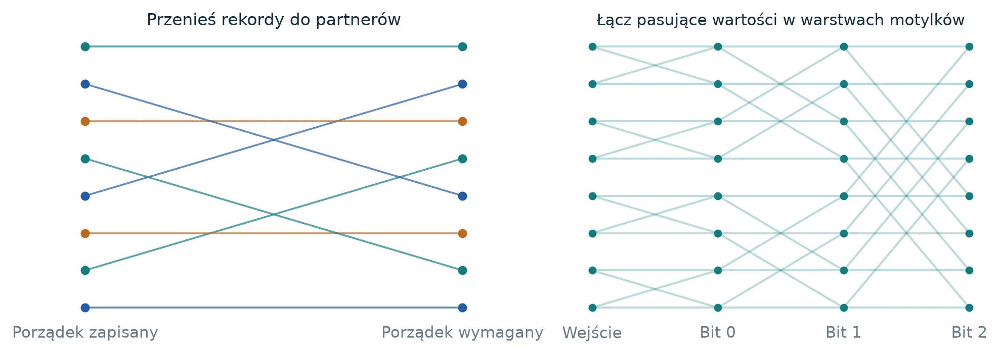
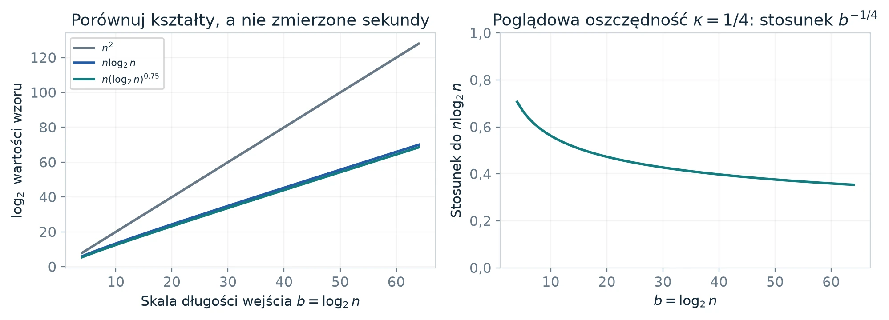
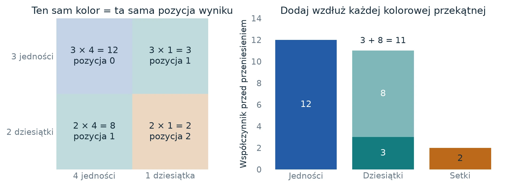
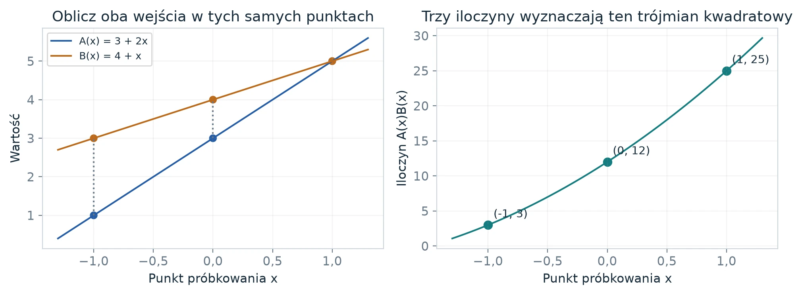
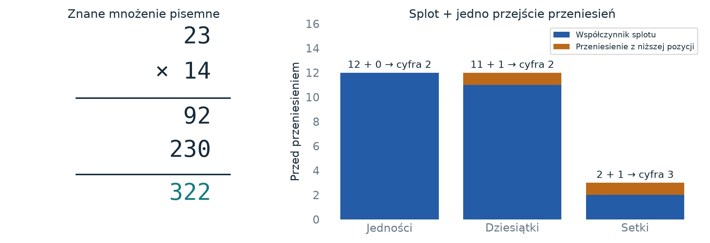
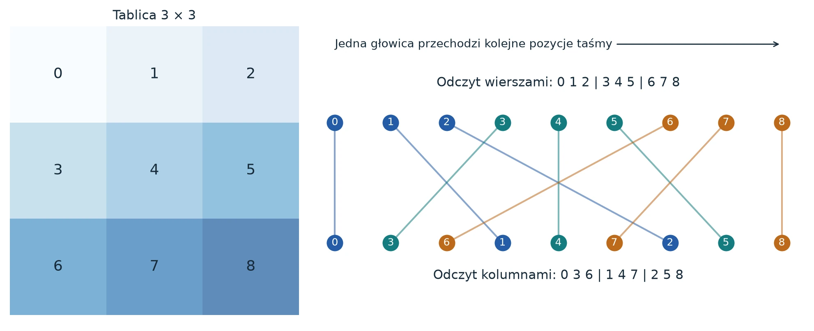
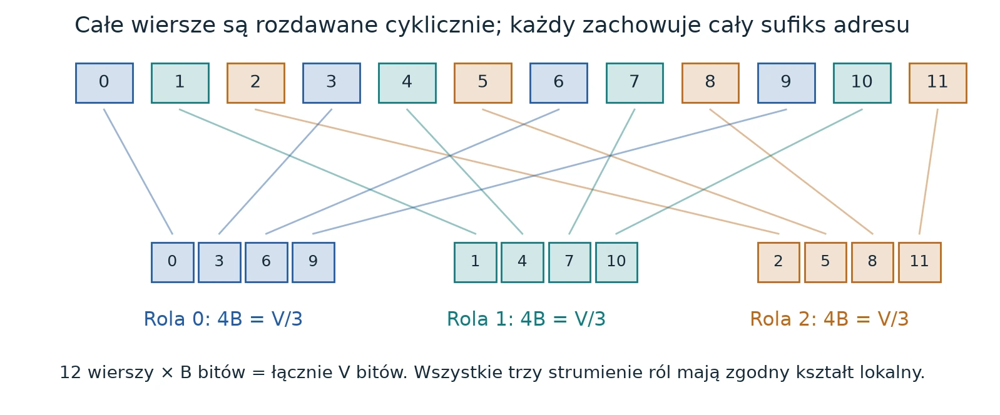

Autor i przekład
<strong>Autor:</strong> <a href="https://github.com/rohanarun/integer-multiplication-illustrated">Rohan Arun</a>, <em>Integer multiplication, illustrated</em> – ilustrowane wydanie pracy OpenAI <em>Integer multiplication below n log n</em> (23 września 2026). Według noty autora objaśnienia, rysunki i skrypty przygotowano przy istotnej pomocy OpenAI Codex.

<strong>Przekład na język polski i wizualizacje interaktywne:</strong> wygenerowane z pomocą Claude (Anthropic), przygotował <a href="https://github.com/hipotures/rad/tree/main/research/integer-multiplication-bounds">hipotures</a>.

Licencja: <a href="https://www.apache.org/licenses/LICENSE-2.0">Apache 2.0</a>. Zmiany względem oryginału: przekład tekstu, przetłumaczone etykiety rysunków, widżety interaktywne oraz ramki „Od tłumacza”.

Seria

<ol>
<li class="is-current">Problem i splot (ta część)</li>
<li><a href="/posts/mnozenie-liczb-calkowitych-2-rama-rzad-rekurencja/">Rama, rząd i rekurencja</a></li>
<li><a href="/posts/mnozenie-liczb-calkowitych-3-od-transformaty-do-wyniku/">Od transformaty do dokładnego wyniku</a></li>
</ol>

Cały przewodnik w jednym pliku: <a href="/posts/mnozenie-liczb-calkowitych-1-problem-i-splot/przewodnik-mnozenie-pl.pdf">PDF, 33 strony</a> (bez widżetów interaktywnych).

Od tłumacza
We wrześniu 2026 roku OpenAI opublikowało preprint, w którym twierdzi, że dwie liczby <em>n</em>-bitowe można pomnożyć w czasie <em>istotnie</em> krótszym niż <em>n</em> log <em>n</em>. Granica <em>n</em> log <em>n</em> była od pół wieku uważana za prawdopodobnie optymalną. Sam preprint to ponad czterdzieści stron gęstej algebry liniowej, analizy Fouriera i teorii złożoności. Rohan Arun przygotował do niego przewodnik: krótkie rozdziały z konkretnymi przykładami i 24 rysunkami, które pokazują rzeczywiste liczby, a nie ogólne schematy.

Ta seria jest przekładem tego przewodnika. Kolejność rozdziałów odpowiada oryginałowi. Rozdziały oznaczone Podstawy wprowadzają pojęcia na prostych przykładach, a oznaczone Technika wiążą je z argumentacją pracy. Przy pierwszym czytaniu można trzymać się podstaw, rysunków i ramek „Co zabrać dalej”. Ramki „Od tłumacza” i widżety interaktywne nie pochodzą z oryginału.

Status wyniku (stan na 12 października 2026)
Streszczenie pracy w przekładzie: <em>„Podajemy deterministyczny algorytm, który mnoży dwie liczby n-bitowe w pesymistycznym czasie \(O(n(\lg n)^{1-\kappa})\), gdzie \(\kappa=2^{-182}\), na jednej ustalonej maszynie Turinga o skończonym alfabecie i ustalonej skończonej liczbie jednowymiarowych taśm. Algorytm jest dokładny dla każdej długości wejścia i obala hipotezę Schönhagego i Strassena o optymalności n log n w tym modelu.”</em>

Praca formułuje to jako twierdzenie, ale nie przeszła jeszcze niezależnej recenzji. Przewodnik ją objaśnia, ale nie weryfikuje. Społeczność skupiona wokół repozytorium <a href="https://github.com/CrocSwap/integer-mult-bounds">CrocSwap/integer-mult-bounds</a> zgłasza lepsze, ale <em>warunkowe</em> wartości wykładnika: obecnie \(\kappa\approx0{,}00152\), przy założeniach, których pełny dowód nie istnieje. Ta seria, tak jak przewodnik, opisuje zamrożoną wersję pracy z \(\kappa=2^{-182}\).

<em>Ujawnienie:</em> hipotures (projekt RaD) jest wymieniony w pliku <a href="https://github.com/CrocSwap/integer-mult-bounds/blob/main/CONTRIBUTORS.md">CONTRIBUTORS.md</a> tego repozytorium jako współtwórca prac społeczności nad poprawą κ (PR #20 i #41). Nie jest współautorem pracy OpenAI ani wydania ilustrowanego.

## Od tłumacza: pół wieku szybszego mnożenia

Krótka oś czasu na podstawie sekcji historycznej oryginalnej pracy. Wszystkie ograniczenia dotyczą liczby operacji bitowych przy mnożeniu dwóch liczb *n*-bitowych.

| Rok | Kto | Ograniczenie |
|---|---|---|
| szkoła | mnożenie pisemne | \(O(n^2)\) |
| 1962 | Karatsuba i Ofman | \(O(n^{\log_2 3})\approx O(n^{1{,}585})\) |
| 1963–1966 | Toom, Cook | \(O(n^{1+\eta})\) dla każdego \(\eta>0\) |
| 1971 | Schönhage i Strassen | \(O(n\log n\log\log n)\), hipoteza: \(n\log n\) jest optymalne |
| 2007 | Fürer | \(n\log n\,2^{O(\log^* n)}\) |
| 2016–2019 | Harvey, van der Hoeven, Lecerf | \(O(n\log n\,8^{\log^* n})\), potem \(4^{\log^* n}\) |
| 2019/2021 | Harvey i van der Hoeven | \(O(n\log n)\) |
| 2026 | OpenAI (preprint, niezweryfikowany) | \(O(n(\log n)^{1-\kappa})\), \(\kappa=2^{-182}\) |

Tu \(\log^* n\) to logarytm iterowany: liczba logarytmowań \(n\) potrzebnych, żeby zejść poniżej stałego progu. Ta funkcja rośnie absurdalnie wolno.

## Zacznij od problemu, nie od symboli

Podstawy Przy pierwszym czytaniu wystarczy zwykła arytmetyka.

Masz dwa długie ciągi cyfr dwójkowych i chcesz poznać ich dokładny iloczyn. Pytanie badawcze dotyczy tego, jak rośnie potrzebna praca, gdy ciągi stają się coraz dłuższe. Nie chodzi o to, czy mnożenie jest w ogóle możliwe, i nie jest to obietnica, że nowy program jutro prześcignie twój kalkulator.

Pomyśl o trzech rachunkach. Jeden płacisz za łączenie liczb, drugi za przesuwanie właściwych kawałków obok siebie, a trzeci za upewnienie się, że wynik końcowy jest dokładny. Praca proponuje sposób, by obniżyć dwa pierwsze rachunki jednocześnie, nadal płacąc trzeci. Ilustracje poniżej pokazują rzeczywiste ścieżki danych: lewy rysunek zmienia miejsce przechowywania rekordów, a prawy łączy pary rekordów łączonych na kolejnych poziomach transformaty.

<figure class="infographic-figure">

<figcaption><strong>Rys. 1.</strong> Dwa odrębne zadania w szybkim mnożeniu. Po lewej: rekordy trzeba ustawić w użytecznej kolejności. Po prawej: ośmioelementowa sieć motylków na każdym poziomie łączy elementy różniące się jednym bitem adresu. To małe ilustracje struktury, a nie ogromny układ z pracy. <small>Ilustracja: Rohan Arun (Apache 2.0), etykiety przetłumaczone.</small></figcaption>
</figure>

**Czym jest bit?** Bit to zero albo jedynka. W systemie dziesiętnym kolejne miejsca to jedności, dziesiątki, setki. W dwójkowym: jedynki, dwójki, czwórki, ósemki. Zatem dwójkowe 1011 oznacza \(1\cdot8+0\cdot4+1\cdot2+1\cdot1=11\). To wejście ma cztery bity. Praca oznacza przez \(n\) długość w bitach, a nie wartość liczby. Wiodące zera są dozwolone: 0011 też jest wejściem czterobitowym, choć jego wartość to trzy.

**Co liczy logarytm?** Dla potęg dwójki \(\log_2 n\) liczy, ile podwojeń prowadzi od jedynki do \(n\). Ponieważ ciąg 1, 2, 4, 8, 16 to cztery podwojenia, \(\log_2 16=4\). Rozróżnienie między \(n\) a \(\log_2 n\) jest kluczowe. Gdy ciąg bitów wydłuża się dwukrotnie, \(n\) się podwaja, a \(\log_2 n\) rośnie zaledwie o jeden.

**Co znaczy wzór na czas działania?** Mnożenie szkolne zestawia każdą z mniej więcej \(n\) cyfr z mniej więcej \(n\) innymi, co daje około \(n^2\) elementarnych iloczynów cyfr. Bardziej wyrafinowane algorytmy unikają liczenia wszystkich tych par osobno. Ograniczenie w rodzaju \(O(n\log n)\) mówi, że powyżej pewnego progu praca wynosi co najwyżej pewną stałą razy \(n\log n\). Nie określa ani tej stałej, ani progu, ani liczby sekund na konkretnym komputerze.

<figure class="infographic-figure">

<figcaption><strong>Rys. 2.</strong> Tempa wzrostu trzeba oglądać we właściwej skali. Po lewej: oś pionowa to logarytm wartości wzoru, więc wartości różniące się wykładniczo mieszczą się na jednym wykresie. Po prawej: podzielenie poglądowego, ulepszonego wzoru przez \(n\log_2 n\) odsłania jego wolniejszy wzrost. Oszczędność 1/4 jest celowo na tyle duża, żeby była widoczna; oryginalna praca używa \(2^{-182}\). Żaden panel nie jest pomiarem programu mnożącego. <small>Ilustracja: Rohan Arun (Apache 2.0), etykiety przetłumaczone.</small></figcaption>
</figure>

**Dwa sposoby czytania.** Przy pierwszym czytaniu idź za przykładami, rysunkami i ramkami „Co zabrać dalej”. Budują one słownictwo, zanim użyje go techniczny wywód. Przy drugim czytaniu przeczytaj równania, a potem odpowiadające im oryginalne dowody w wydaniu rozszerzonym. Zrozumienie, dlaczego elementy do siebie pasują, to inny cel niż sprawdzenie każdego twierdzenia. Przewodnik służy pierwszemu celowi i wskazuje drogę do drugiego; nie zamienia pełnego dowodu w elementarną arytmetykę.

**Szybki sprawdzian.** Jeśli wejście rośnie z 16 do 32 bitów, \(n\) się podwaja, a \(\log_2 n\) rośnie z czterech do pięciu. Wartość liczby wejściowej może być nieporównanie większa niż 32. Trzymanie tych trzech wielkości osobno zapobiega wielu późniejszym nieporozumieniom.

Co zabrać dalej
Praca próbuje zaoszczędzić odrobinę pracy na ogromnej liczbie skal. Żeby ją zrozumieć, śledź zarówno arytmetykę, jak i ruch danych.

## Pytanie, twierdzenie i jak to czytać

Technika Zacznij tutaj; znajomość analizy Fouriera nie jest potrzebna.

Mnożenie wydaje się sprawą zamkniętą, kiedy uczymy się go w szkole. Liczba elementarnych kroków potrzebnych do pomnożenia dwóch niezwykle długich ciągów dwójkowych to jednak zupełnie inne pytanie. Długość wejścia to liczba bitów, a nie wartość liczbowa. Liczba o milionie bitów jest jednym wejściem długości miliona; to, że jej wartość może być bliska \(2^{1\,000\,000}\), niczego w tej długości nie zmienia.

Omawiany tu manuskrypt to praca OpenAI *Integer multiplication below \(n\log n\)* z 23 września 2026 roku, w wersji ze źródłowego commitu `adc7f1241b42e322a6451854ab7e4b4c146bf78a`. Podaje ona pesymistyczne ograniczenie

\[
 T(n)=O\bigl(n(\lg n)^{1-\kappa}\bigr),\qquad \kappa=2^{-182}.
\]

Tutaj \(\lg n=\max\{\lceil\log_2 n\rceil,1\}\). Maszyna musi zwrócić dokładny iloczyn dla każdego wejścia, także dla wejść z wiodącymi zerami. Model maszyny używa ustalonego skończonego alfabetu i ustalonej skończonej liczby jednowymiarowych taśm. Odczyt, zapis i przesuwanie danych kosztują czas.

**Co to wydanie ustala, a czego nie.** Oryginalny tekst formułuje swój wynik jako twierdzenie. To wydanie objaśnia argumentację, ale nie potwierdza niezależnie jej poprawności. Repozytorium społeczności traktuje swoje ulepszenia jako warunkowe, zależne od oryginalnej konstrukcji oraz zachowanych interfejsów implementacyjnych i analitycznych. To rozróżnienie jest ważne: sprawdzenie dokładnej skończonej sieci albo listy nierówności wymiernych nie dowodzi samo w sobie, że jedna maszyna taśmowa realizuje cały algorytm w deklarowanym czasie dla wszystkich rozmiarów wejścia. Twierdzenia oryginału pozostają w pełnym wydaniu tekstem źródłowym i przewodnik nie przedstawia ich jako nowych wyników. To niezależnie przygotowane wydanie objaśniające, a nie oficjalna rewizja ani rekomendacja OpenAI.

**Dlaczego maleńki dodatni wykładnik ma znaczenie.** Pomijając na chwilę stałe, podzielmy proponowane ograniczenie przez \(n\log_2 n\). Iloraz to \((\log_2 n)^{-\kappa}\), który dąży do zera dla każdego ustalonego \(\kappa>0\). To rozróżnienie asymptotyczne, choćby \(\kappa\) było nie wiadomo jak małe. Nie jest to zapowiedź użytecznego przyspieszenia na komputerze. Nawet sprowadzenie tego wyidealizowanego stosunku do \(1/2\) wymaga

\[
 (\log_2 n)^\kappa=2,
 \qquad \log_2 n=2^{1/\kappa},
 \qquad n=2^{\,2^{1/\kappa}}.
\]

Przy \(\kappa=2^{-182}\) to niewyobrażalna skala. Nieznane stałe, progi i rzeczywista implementacja sprawiają, że praktyczne porównanie jest jeszcze trudniejsze. Większe \(\kappa\) oznacza lepszą oszczędność w wykładniku, a nie taką samą procentową poprawę zmierzonego czasu działania.

Widżet interaktywny wymaga JavaScriptu.

**Argumentacja w jednym akapicie.** Zamień mnożenie cyfr na splot. Za pomocą transformat zamień splot na mniejsze iloczyny punktowe. Spraw, żeby dwa kosztowne składniki stały się tańsze: przestawianie adresów przechowywanych danych i wykonywanie wielu dwupunktowych kroków transformaty. Oba ulepszenia biorą się ze skończonych sieci liniowych, których pośrednie reprezentacje dobrano starannie. Udowodnij oszczędność rekurencyjną po wliczeniu każdej roli pomocniczej i każdej zmiany reprezentacji. Następnie pokaż, że układy danych, przepróbkowanie, precyzja i dokładne odtworzenie wyniku mieszczą się w tym samym końcowym ograniczeniu.

**Droga przez wydanie rozszerzone.** Nowe rozdziały podstaw wprowadzają każde potrzebne pojęcie na konkretnym przykładzie, zanim pojawi się ono w części technicznej. Najpierw przeczytaj przykład z cyframi i objaśnienie dotyczące taśm. Potem odtwarzanie rejestru pomocniczego, wspólne ramy i rekurencję – one wyjaśniają, skąd bierze się proponowana oszczędność. Przykłady z motylkami i wielomianami pokazują, co tę oszczędność zjada. Ostatnie rozdziały tłumaczą, dlaczego porządkowania i zaokrąglania nie można zostawić na koniec. W pełnym wydaniu każde dodane objaśnienie poprzedza oryginalny materiał techniczny, który oświetla. Numeracja sekcji, równań, twierdzeń i rysunków oryginału jest zachowana.

Co zabrać dalej
Główne pytanie brzmi: czy całe obliczenie, łącznie z ruchem danych i dokładnym odtworzeniem wyniku, może zaoszczędzić dodatnią potęgę \(\log n\)?

**Źródło i atrybucja.** Oryginalna praca i jej bibliografia są zachowane na licencji Apache 2.0 w dołączonym pakiecie źródłowym. Jej część historyczna przypisuje zasługi m.in. Schönhagemu i Strassenowi, Harveyowi i van der Hoevenowi, Nussbaumerowi i Quandalle’owi. Repozytorium CrocSwap osobno zachowuje wkład społeczności. Nowe objaśnienia, rysunki i sprawdzenia przykładów w tym wydaniu przygotowano z pomocą OpenAI Codex 12 października 2026 roku. Źródło jest zamrożone; ten dokument nie jest bieżącym rankingiem rekordów.

## Zobacz dokładnie, które iloczyny cyfr się sumują

Podstawy Splot bez nowej maszynerii.

Każdy składnik mnożenia pisemnego ma swoje miejsce docelowe. W \(23\times14\) iloczyn \(3\times4\) trafia do jedności. Zarówno \(3\times1\), jak i \(2\times4\) trafiają do dziesiątek, bo jeden czynnik w każdym z tych iloczynów jest cyfrą dziesiątek. Wreszcie \(2\times1\) trafia do setek. Kolory przekątnych w siatce wskazują te miejsca docelowe.

<figure class="infographic-figure">

<figcaption><strong>Rys. 3.</strong> Splot to dodawanie wzdłuż przekątnych o tej samej pozycji. Dwie turkusowe komórki wnoszą 3 i 8 do tego samego współczynnika, co daje 11. Lista współczynników przed przeniesieniami to \([12,11,2]\). Komórka to konkretny iloczyn cyfr, a nie ogólny etap algorytmu. <small>Ilustracja: Rohan Arun (Apache 2.0), etykiety przetłumaczone.</small></figcaption>
</figure>

Ponumeruj pozycje cyfr od zera. Cyfra na pozycji \(i\) pomnożona przez cyfrę na pozycji \(j\) trafia na pozycję \(i+j\), bo \(10^i10^j=10^{i+j}\). Na tym polega cała reguła „dodawaj iloczyny o tej samej sumie pozycji”. Nazwa *splot* oznacza właśnie tę regułę. Działa ona tak samo w systemie dwójkowym i w każdej innej podstawie.

Widżet interaktywny wymaga JavaScriptu.

**Po co przechodzić do wielomianu?** Zastąp podstawę dziesięć zmienną \(x\). Oba wejścia stają się wielomianami \(A(x)=3+2x\) i \(B(x)=4+x\). Ich iloczyn jest kwadratowy: można go zapisać jako \(C(x)=c_0+c_1x+c_2x^2\) z trzema nieznanymi współczynnikami. Dla \(x=10\) musi dać iloczyn liczb całkowitych. Ale dziesięć to niejedyny przydatny punkt, w którym można go obliczyć. Łatwiejsze punkty próbkowania mogą ujawnić jego współczynniki.

<figure class="infographic-figure">

<figcaption><strong>Rys. 4.</strong> Najpierw policz wartości, potem odtwórz współczynniki. W punktach \(x=-1,0,1\) iloczyny wartości wejść wynoszą 3, 12 i 25. Przez trzy różne punkty przechodzi dokładnie jeden wielomian stopnia co najwyżej drugiego. Krzywe to te konkretne wielomiany, a nie metafora transformaty. <small>Ilustracja: Rohan Arun (Apache 2.0), etykiety przetłumaczone.</small></figcaption>
</figure>

W zerze \(C(0)=c_0=3\times4=12\). W jedynce \(C(1)=5\times5=25\). W minus jedynce \(C(-1)=1\times3=3\). Zatem

\[
 c_0=12,\qquad
 c_1=\frac{25-3}{2}=11,\qquad
 c_2=\frac{25+3}{2}-12=2.
\]

Odjęcie dwóch ostatnich równań wyodrębnia wyraz z nieparzystą potęgą, a ich dodanie – wyrazy z parzystymi potęgami. Obliczenie w dziesięciu daje teraz \(12+11\cdot10+2\cdot100=322\).

**Gdzie ten przykład się kończy.** Ten maleńki przykład interpolacji to nie szybki algorytm z pracy. Pokazuje tylko, dlaczego schemat „oblicz wartości, pomnóż odpowiadające sobie wartości, odtwórz współczynniki” w ogóle może działać. Dla ogromnych wejść samo obliczanie wartości i odtwarzanie muszą być szybkie i dobrze kontrolowane. Transformaty Fouriera wybierają silnie ustrukturyzowane punkty próbkowania, dzięki czemu te kroki mogą dzielić się pracą. Kolejny rozdział podstaw (w części 2) wyjaśnia, jak wyglądają ich wzorce.

Co zabrać dalej
Splot grupuje iloczyny trafiające na to samo miejsce. Transformata daje inny sposób obliczenia tych samych współczynników, ale nie zmienia iloczynu.

## Od mnożenia pisemnego do splotu

Technika Kompletny mały przykład.

Zapisz liczbę całkowitą w podstawie \(B\) jako \(a_0+a_1B+\cdots+a_{q-1}B^{q-1}\). Cyfry są wymienione od najmniej do najbardziej znaczącej. W objaśnieniu przyjmijmy \(B=10\); praca używa potęgi dwójki, żeby podział na cyfry był operacją dwójkową. Wprowadź zmienną formalną \(x\) i utwórz \(A(x)=\sum_i a_i x^i\). Wtedy oryginalna liczba to dokładnie \(A(B)\).

Dla dwóch wejść współczynniki iloczynu wielomianów spełniają

\[
 A(x)B(x)=\sum_k c_k x^k,\qquad c_k=\sum_{i+j=k}a_i b_j.
\]

Drugi wielomian wejściowy oznaczamy tu \(B(x)\); samo \(B\) bez nawiasu wciąż oznacza podstawę. Suma definiująca \(c_k\) to właśnie *splot*. Grupuje iloczyny cyfr o tej samej wartości pozycyjnej. W odróżnieniu od cyfr współczynniki \(c_k\) mogą przekraczać podstawę. Naprawiają to przeniesienia, wykonane już po obliczeniu współczynników.

<figure class="infographic-figure">

<figcaption><strong>Rys. 5.</strong> Jedno mnożenie, trzy reprezentacje. Lista współczynników \([12,11,2]\) odpowiada potęgom \(x^0,x^1,x^2\). Przeniesienie przechodzi z niższych pozycji na wyższe. Wynik to 322. <small>Ilustracja: Rohan Arun (Apache 2.0), etykiety przetłumaczone.</small></figcaption>
</figure>

Dla \(23\cdot14\) współczynnik przy \(x\) wynosi \(3\cdot1+2\cdot4=11\). Na pozycji zero liczba 12 zapisuje cyfrę 2 i przenosi 1. Pozycja pierwsza dostaje \(11+1=12\), znowu zapisuje 2 i przenosi 1. Pozycja druga dostaje \(2+1=3\). To zwykłe mnożenie, tylko inaczej zorganizowane – na razie bez żadnych przybliżeń.

**Skąd biorą się transformaty.** Dla odpowiedniej transformaty \(F\) splot można odtworzyć z iloczynów odpowiadających sobie elementów transformat. Obliczenie dwóch wielomianów w wielu pierwiastkach z jedynki, pomnożenie tych wartości i transformacja odwrotna zastępują mnóstwo iloczynów krzyżowych ustrukturyzowanymi dodawaniami i iloczynami punktowymi. Zysk zależy od tego, czy transformaty da się tanio obliczyć i tanio ułożyć ich dane wejściowe. Transformaty w pracy są znormalizowane, więc znane czynniki skali trzeba przywrócić; hasło „transformuj, pomnóż, odwróć” te czynniki ukrywa.

**Dlaczego potrzebne jest dopełnianie zerami.** Splot cykliczny (kołowy) traktuje pozycje modulo długość \(S\). Wkład na pozycji \(S\) zawija się wtedy na pozycję zero. Algebraicznie to wygodne, ale zepsułoby iloczyn liczb całkowitych. Dla stopnia co najwyżej \(2q-2\) wybranie \(S>2q-2\) i wypełnienie nieużywanych miejsc zerami zapobiega niezerowemu zawinięciu. Oryginalne składanie wyniku dowodzi, że wybrany iloczyn wzdłuż osi o długościach pierwszych ma wystarczającą pojemność. Ogranicza też każdy współczynnik, zanim wybierze precyzję do jego przechowania.

Co zabrać dalej
Trudne zadanie polega teraz na tym, żeby wszystkie współczynniki splotu policzyć tanio i na tyle dokładnie, by odtworzyć liczby całkowite, a potem raz wykonać przeniesienia.

Miejsca w oryginale: <a href="https://github.com/openai/math/blob/adc7f1241b42e322a6451854ab7e4b4c146bf78a/preprints/Integer-multiplication-below-n-log-n-September-23-2026/build/sections/00-introduction.tex"><code>00-introduction.tex</code></a>; <a href="https://github.com/openai/math/blob/adc7f1241b42e322a6451854ab7e4b4c146bf78a/preprints/Integer-multiplication-below-n-log-n-September-23-2026/build/sections/08-assembly.tex"><code>08-assembly.tex</code></a>, <code>eq:capacity</code>.

## Transpozycja macierzy to fizyczne przestawienie

Podstawy Prześledź wszystkie dziewięć rekordów.

Odczytaj siatkę \(3\times3\) wierszami: 0, 1, 2, 3, 4, 5, 6, 7, 8. Teraz odczytaj ją kolumnami: 0, 3, 6, 1, 4, 7, 2, 5, 8. Same rekordy się nie zmieniły. Zmieniło się ich położenie w strumieniu. Krzyżujące się ścieżki pokazują dokładną permutację, łącznie z rekordami, które zostają na miejscu.

<figure class="infographic-figure">

<figcaption><strong>Rys. 6.</strong> Geometria jednego konkretnego przeniesienia danych. Kolory oznaczają oryginalne wiersze, a każdy ponumerowany rekord jest połączony ze swoim miejscem docelowym. Strzałka u góry przedstawia głowicę taśmy przesuwającą się po kolejnych pozycjach. Głowica nie może teleportować się do następnego potrzebnego rekordu. <small>Ilustracja: Rohan Arun (Apache 2.0), etykiety przetłumaczone.</small></figcaption>
</figure>

Program komputerowy może zapisać nowy wzór indeksowania w jednej linijce. To jednak nie dowodzi, że rekordy zostały fizycznie przestawione w jednym kroku. W modelu maszyny z pracy głowica przesuwa się w jednym kroku o co najwyżej jedną komórkę taśmy. Duży ruch danych trzeba więc zrealizować i za niego zapłacić.

**Dlaczego obliczenie może pomóc w permutacji.** Dla pary bitów trzy aktualizacje XOR zamieniają ich wartości:

\[
 x\leftarrow x\mathbin{\mathrm{XOR}}y,\quad
 y\leftarrow y\mathbin{\mathrm{XOR}}x,\quad
 x\leftarrow x\mathbin{\mathrm{XOR}}y.
\]

Dla stanu początkowego \((x,y)=(1,0)\) kolejne stany to \((1,0),(1,1),(0,1)\). XOR to dodawanie modulo dwa: równe bity dają zero, różne dają jedynkę. Wartości pośrednie są kombinacjami, a mimo to wynik końcowy jest czystą zamianą. Duża konstrukcja również używa pośrednich kombinacji liniowych, żeby uzyskać pożądaną operację na całej tablicy. Ta tożsamość dla dwóch bitów wyjaśnia jedynie, że jest to możliwe; nie dowodzi szybkości dużej konstrukcji.

**Dwa znaczenia geometrii trzymaj osobno.** Siatka przedstawia tu pozycje w tablicy. Podprzestrzenie i rzędy pojawiające się później przedstawiają algebraiczne kierunki operatorów działających na takich tablicach. Rysunek krótkiej fizycznej ścieżki nie jest sam w sobie świadectwem niskiego rzędu, a tożsamość niskiego rzędu nie jest sama w sobie ograniczeniem czasu na taśmie. Argumentacja potrzebuje precyzyjnego połączenia między nimi.

Co zabrać dalej
Kolejność przechowywania jest częścią problemu. Użyteczne przestawienie trzeba wykonać prawdziwymi krokami, a nie samą zmianą nazw indeksów.

## Dlaczego przesuwanie danych jest częścią matematyki

Technika Do przeczytania przed sekcją o modelu maszyny.

Wyobraź sobie długi rząd ponumerowanych pudełek i głowicę, która przesuwa się o jedno pudełko na krok. Numer to adres pojęciowy; maszyna nie dostaje darmowego dostępu swobodnego tylko dlatego, że na papierze możemy napisać \(A[i,j]\). Tablica wielowymiarowa zostaje spłaszczona do jednego uporządkowanego strumienia. W porządku leksykograficznym najszybciej zmienia się ostatnia współrzędna. Dla tablicy \(2\times3\) kolejność to

\[
 (0,0),(0,1),(0,2),(1,0),(1,1),(1,2).
\]

Przejście na odwrotną kolejność współrzędnych przestawia rekordy. Na tej maszynie koszt obejmuje doprowadzenie ich na te pozycje.

**Rola to miejsce w układzie; wiersz to blok danych.** Skończona sieć ma \(W\) ról, licząc zarówno role danych, jak i role pomocnicze. W węźle rekurencji kompletne wiersze są rozdzielane między nie cyklicznie. Wiersz zawiera cały sufiks aktywnych pól adresu. Dzięki tej kompletności każda rola widzi ten sam lokalny zbiór adresów. Po odpowiednim dopełnieniu każda rola dostaje dokładnie ułamek \(1/W\) logicznej objętości.

<figure class="infographic-figure">

<figcaption><strong>Rys. 7.</strong> Podział objętości, który napędza rekurencję. Każdy poglądowy wiersz ma \(B\) bitów. Dwanaście wierszy daje \(V=12B\); trzy strumienie ról mają po \(4B\). Prawdziwa praca używa znacznie większych ustalonych sieci. <small>Ilustracja: Rohan Arun (Apache 2.0), etykiety przetłumaczone.</small></figcaption>
</figure>

**Dlaczego liczymy także role pomocnicze.** Załóżmy, że liczylibyśmy tylko użyteczne wiersze wyniku, zapominając o pamięci roboczej. Konstrukcja mogłaby wtedy wyglądać na tanią tylko dlatego, że ukrywa dużą ilość danych tymczasowych. \(W\) w sieci liczy wszystkie role. Role pomocnicze mogą zawierać dowolne istniejące dane, bo układ skalarny przywraca ich zawartość. Nie zakładamy, że są darmową, wyzerowaną pamięcią. Późniejsza operacja na tablicy w ramie musi działać poprawnie także na tych rolach.

**Objętość logiczna nie zwalnia z liczenia kopiowania.** \(V\) oznacza objętość danych, którą normalizuje się wywołanie rekurencyjne. Fizyczne kopie, dopełnianie, aktualizacje liczników, powroty głowicy i sprzątanie wciąż zajmują czas. Są wliczane jako narzut. Gdy aktywne jest dziecko, harmonogram z pracy „parkuje” strumienie rodzica i przywraca je po powrocie. Deklarowany rachunek wymaga, by nie przechodzić wielokrotnie przez wszystkich zaparkowanych przodków.

**Ustalona maszyna wciąż może obsługiwać rosnące deskryptory.** Długości wejścia, długości osi i stany wywołań są przechowywane jako dane. Liczba taśm i alfabet nie mogą rosnąć wraz z \(n\). Dlatego dowód dotyczący skończonego układu jest tylko jednym składnikiem: trzeba go przenieść na jednolite operacje na strumieniach z jawnie policzonym kosztem obsługi tych deskryptorów.

Co zabrać dalej
Śledź zarówno liczbę wywołań rekurencyjnych, jak i ilość danych przetwarzanych przez każde wywołanie. Oszczędność w jednym może zniknąć, jeśli źle policzysz drugie.

Miejsca w oryginale: <a href="https://github.com/openai/math/blob/adc7f1241b42e322a6451854ab7e4b4c146bf78a/preprints/Integer-multiplication-below-n-log-n-September-23-2026/build/sections/02-streams.tex"><code>02-streams.tex</code></a>, <code>lem:elementary-streams</code>.

---

**Dalej:** [część 2 – rama, rząd i rekurencja](/posts/mnozenie-liczb-calkowitych-2-rama-rzad-rekurencja/).

## Źródła

1. Rohan Arun, [*Integer multiplication, illustrated*](https://github.com/rohanarun/integer-multiplication-illustrated) – wydanie ilustrowane, przewodnik (31 s.) i wydanie rozszerzone z oryginalnymi dowodami (105 s.), Apache 2.0.
2. OpenAI, [*Integer multiplication below n log n*](https://github.com/openai/math/tree/adc7f1241b42e322a6451854ab7e4b4c146bf78a/preprints/Integer-multiplication-below-n-log-n-September-23-2026), 23 września 2026, commit `adc7f12`.
3. [CrocSwap/integer-mult-bounds](https://github.com/CrocSwap/integer-mult-bounds) – prace społeczności nad warunkowymi ulepszeniami κ; [lista współtwórców](https://github.com/CrocSwap/integer-mult-bounds/blob/main/CONTRIBUTORS.md).
4. hipotures, [projekt RaD: integer-multiplication-bounds](https://github.com/hipotures/rad/tree/main/research/integer-multiplication-bounds).
5. D. Harvey, J. van der Hoeven, [*Integer multiplication in time O(n log n)*](https://annals.math.princeton.edu/2021/193-2/p04), Annals of Mathematics 193 (2021); [wersja HAL](https://hal.archives-ouvertes.fr/hal-02070778).
6. A. Schönhage, V. Strassen, *Schnelle Multiplikation großer Zahlen*, Computing 7 (1971), 281–292.
