

Autor i przekład
<strong>Autor:</strong> <a href="https://github.com/rohanarun/integer-multiplication-illustrated">Rohan Arun</a>, <em>Integer multiplication, illustrated</em> – ilustrowane wydanie pracy OpenAI <em>Integer multiplication below n log n</em> (23 września 2026). Według noty autora objaśnienia, rysunki i skrypty przygotowano przy istotnej pomocy OpenAI Codex.

<strong>Przekład na język polski i wizualizacje interaktywne:</strong> wygenerowane z pomocą Claude (Anthropic), przygotował <a href="https://github.com/hipotures/rad/tree/main/research/integer-multiplication-bounds">hipotures</a>.

Licencja: <a href="https://www.apache.org/licenses/LICENSE-2.0">Apache 2.0</a>. Zmiany względem oryginału: przekład tekstu, przetłumaczone etykiety rysunków, widżety interaktywne oraz ramki „Od tłumacza”. Status wyniku i ujawnienia opisuje <a href="/posts/mnozenie-liczb-calkowitych-1-problem-i-splot/">część 1</a>.

Seria

<ol>
<li><a href="/posts/mnozenie-liczb-calkowitych-1-problem-i-splot/">Problem i splot</a></li>
<li class="is-current">Rama, rząd i rekurencja (ta część)</li>
<li><a href="/posts/mnozenie-liczb-calkowitych-3-od-transformaty-do-wyniku/">Od transformaty do dokładnego wyniku</a></li>
</ol>

Cały przewodnik w jednym pliku: <a href="/posts/mnozenie-liczb-calkowitych-1-problem-i-splot/przewodnik-mnozenie-pl.pdf">PDF, 33 strony</a> (bez widżetów interaktywnych).

Od tłumacza
Część 1 zamieniła mnożenie w splot i pokazała, że ruch danych na taśmie kosztuje. Ta część wyjaśnia, skąd bierze się oszczędność: rejestr pomocniczy można pożyczyć i oddać nietknięty, wspólna rama reprezentacji zachowuje dodawanie, a rekurencja, która wywołuje więcej podproblemów na mniejszych danych, może kosztować mniej niż metoda naiwna. Na końcu pojawiają się wzorce częstotliwości i motylki, czyli najmniejsze kroki transformaty.

## Wektory, rząd i rama, którą można narysować

Podstawy Geometria stojąca za technicznym słownictwem.

Wektor może być tak prosty jak para liczb, na przykład \((1,2)\). Narysuj go jako strzałkę od początku układu do tego punktu. Dodawanie wektorów dodaje ich współrzędne. Mnożenie przez liczbę skaluje strzałkę. Podprzestrzeń to zbiór zamknięty na te działania: przykładem jest prosta przechodząca przez początek układu, a innym cała płaszczyzna.

Macierz to reguła łączenia współrzędnych wejścia we współrzędne wyjścia. Jej kolumny mówią, dokąd trafiają podstawowe kierunki wejściowe. Jeśli każde wyjście leży na jednej prostej, istnieje tylko jeden niezależny kierunek wyjścia, nawet gdy macierz ma wiele niezerowych elementów. Ta liczba niezależnych kierunków to jej rząd.

<figure class="infographic-figure">
<a class="infographic-figure-link fig-light" href="images/17-rank-directions.webp" target="_blank" rel="noopener">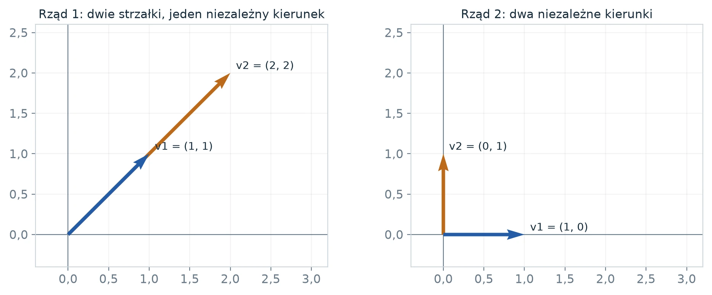</a><a class="infographic-figure-link fig-dark" href="images/17-rank-directions-dark.webp" target="_blank" rel="noopener">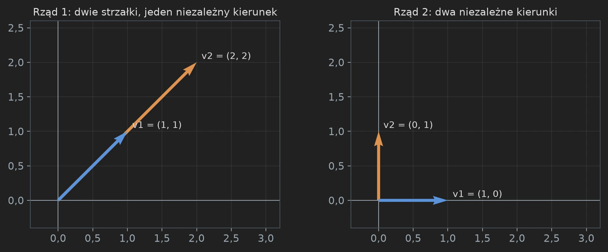</a>
<figcaption><strong>Rys. 8.</strong> Licz niezależne kierunki, a nie strzałki. Po lewej \((2,2)\) to dwukrotność \((1,1)\): obie strzałki leżą na jednej prostej. Po prawej żadna wielokrotność \((1,0)\) nie daje \((0,1)\): potrzebne są oba kierunki. To odpowiednio rząd jeden i rząd dwa. <small>Ilustracja: Rohan Arun (Apache 2.0), etykiety przetłumaczone.</small></figcaption>
</figure>

Macierze

\[
 \begin{pmatrix}1&2\\1&2\end{pmatrix}
 \quad\text{i}\quad
 \begin{pmatrix}1&0\\0&1\end{pmatrix}
\]

mają rzędy jeden i dwa. Pierwsza ma cztery niezerowe elementy, ale niższy rząd. Dla pierwszej macierzy wejście \((s,t)\) daje \((s+2t,s+2t)\), zawsze na prostej przekątnej. Druga może dać każdy punkt płaszczyzny. Dlatego liczenie elementów macierzy przeoczyłoby oszczędność, której szuka praca.

**Rama (ang. *frame*) to spójna reguła reprezentacji.** Niech \(D\) obraca każdy wektor o ćwierć obrotu przeciwnie do ruchu wskazówek zegara. Wartość logiczna \((1,0)\) jest przechowywana jako \((0,1)\). Wartość logiczna \((0,1)\) jest przechowywana jako \((-1,0)\). Suma przechowywanych wartości to \((-1,1)\), czyli dokładnie obrót sumy logicznej \((1,1)\). Oba wejścia używały tej samej reguły, więc dodawanie zachowało sens.

<figure class="infographic-figure">
<a class="infographic-figure-link fig-light" href="images/18-frame-example.webp" target="_blank" rel="noopener">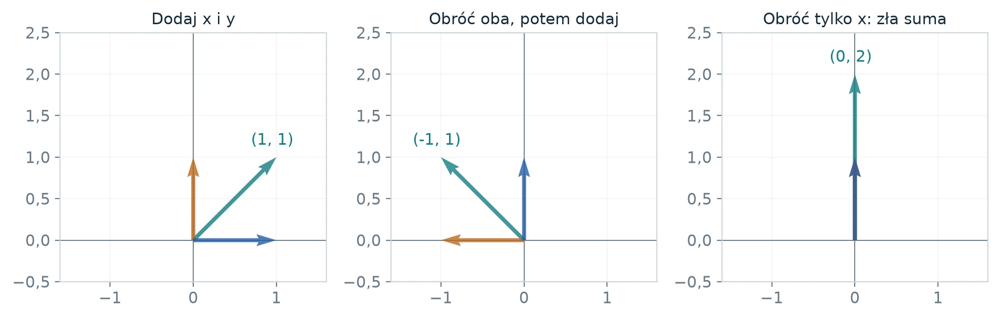</a><a class="infographic-figure-link fig-dark" href="images/18-frame-example-dark.webp" target="_blank" rel="noopener">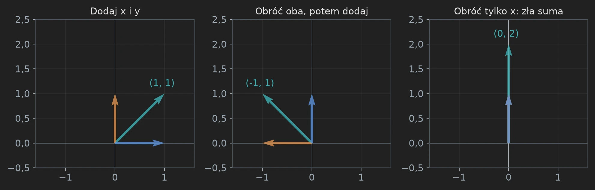</a>
<figcaption><strong>Rys. 9.</strong> Mieszanie reprezentacji zmienia wynik. Niebieski i złoty to dwa wejścia, turkusowy to ich suma. Obrócenie obu wejść daje obróconą poprawną sumę. Obrócenie tylko pierwszego daje \((0,2)\), co nie jest zamierzonym obróconym wynikiem \((-1,1)\). Nakładające się strzałki w prawym panelu celowo pokazują dwa równe kierunki. <small>Ilustracja: Rohan Arun (Apache 2.0), etykiety przetłumaczone.</small></figcaption>
</figure>

W pracy rama działa na całej tablicy indeksowanej adresami, a nie tylko na wektorze o dwóch liczbach. Obowiązuje to samo prawo liniowości. Późniejszy rysunek z kafelkami \(2\times2\) pokazuje konkretną wersję tablicową: obróć siatkę adresów każdego wejścia, a potem dodaj odpowiadające sobie komórki. Otrzymasz obróconą sumę.

**Dlaczego zmiana ramy może się opłacać.** Jedna reprezentacja może sprawić, że tania będzie jedna bramka, a inna, że tania będzie następna. Algorytm może się między nimi przełączać, pod warunkiem że płaci za przełączenie i konsekwentnie zachowuje interpretację. Ramy na końcach wyznaczają zamierzoną operację końcową; ramy pośrednie dobiera się tak, żeby suma kosztów przejść była mała. Prawdziwy dowód używa bardziej wyrafinowanych operatorów niż obroty i jawnie sprawdza ich rzędy resztowe.

Co zabrać dalej
Rząd mierzy liczbę niezależnych kierunków. Rama to odwracalna reprezentacja. Wspólne ramy zachowują bramki liniowe; niepoliczone zmiany ram ukrywałyby prawdziwą pracę.

## Pożyczona pamięć robocza i zmiana reprezentacji

Technika Do przeczytania przed dowodem dotyczącym skończonej sieci.

Współpracują tu dwie idee, które na początku wydają się niezwiązane. Po pierwsze, obliczenie liniowe może pożyczyć rejestr, nie znając jego zawartości, pod warunkiem że usunie wpływ tej zawartości i ją przywróci. Po drugie, tablice mogą być reprezentowane w różnych układach współrzędnych w różnych miejscach układu. Koszt zmiany reprezentacji może być mniejszy niż koszt bezpośredniego wykonania pożądanej operacji na całej tablicy.

**Przykład odtworzenia w czterech krokach.** Niech \(a\) będzie dowolną wartością pomocniczą. Zaczynając od \((x,y,a)\), wykonaj

\[
 y\leftarrow y-a,\quad a\leftarrow a+x,\quad
 y\leftarrow y+a,\quad a\leftarrow a-x.
\]

Stan końcowy to \((x,y+x,a)\). Początkowe \(a\) znosi się w rejestrze docelowym, a rejestr pomocniczy wraca dokładnie do wartości początkowej. To poglądowa tożsamość w pierścieniu z dodawaniem, a nie proponowana implementacja pełnej sieci. W charakterystyce dwa zarówno dodawanie, jak i odejmowanie stają się operacją XOR.

<figure class="infographic-figure">
<a class="infographic-figure-link fig-light" href="images/03-restoration.webp" target="_blank" rel="noopener">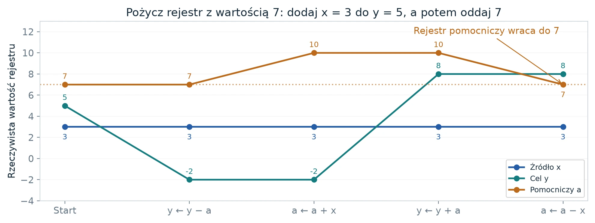</a><a class="infographic-figure-link fig-dark" href="images/03-restoration-dark.webp" target="_blank" rel="noopener">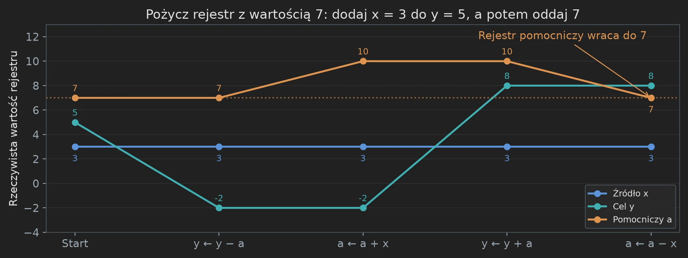</a>
<figcaption><strong>Rys. 10.</strong> Nieznane nie znaczy bezużyteczne. Na wykresie rejestry startują od \(x=3\), \(y=5\), \(a=7\). Rejestr docelowy kończy na ośmiu, a źródło i rejestr pomocniczy wracają do trzech i siedmiu. Tożsamość symboliczna powyżej wyjaśnia, dlaczego działa to dla dowolnych wartości początkowych, a nie tylko dla tego przebiegu. <small>Ilustracja: Rohan Arun (Apache 2.0), etykiety przetłumaczone.</small></figcaption>
</figure>

Widżet interaktywny wymaga JavaScriptu.

**Jak prawdziwa sieć wyodrębnia właściwe źródło.** Oryginalna konstrukcja indeksuje wartości trójkami \(S,T\subseteq[h]\). Zbieranie przez współrzędne wspólne dla trójek daje współczynnik zależny od \(|S\cap T|\). Układ boczny znosi niechciane wyrazy krzyżowe. W wersji bitowej współczynnik centralny to \(|S\cap T|\) modulo dwa: przecięcia rozmiaru zero i dwa już znikają, przecięcie rozmiaru jeden zostaje zniesione, a samoprzecięcie rozmiaru trzy zostawia jedynkę. Wypadkowa aktualizacja celu to więc \(y_S\leftarrow y_S+x_S\). W wersji zespolonej współczynnik centralny to \((|S\cap T|-1)/2\); wyrazy boczne znoszą różne od siebie przypadki przecięcia zero i dwa. W obu przypadkach harmonogram odtwarzania rejestrów pomocniczych usuwa ich stare wartości.

Trzy aktualizacje bloków dają

\[
 (x,y)\to(x,y+x)\to(-y,y+x)\to(-y,x).
\]

To zamiana ze zmianą znaku; na bitach minus znika. Sama sieć nie wykonała jeszcze szybkiej transformaty. Dostarcza algebraicznego rusztowania.

**Co znaczy rama.** Niech \(g\) będzie tablicą logiczną w jednej roli. Rama to odwracalny operator liniowy \(D\) działający na elementach tej tablicy indeksowanych adresami. Przechowywana tablica to \(Dg\). Bramka punktowa natomiast łączy różne role pod tym samym adresem. Dla bramki dodającej dwie role wspólna rama daje

\[
 Dg_1+Dg_2=D(g_1+g_2).
\]

To zwykła liniowość, ale wymaga *tej samej* ramy \(D\) przy każdym wystąpieniu tej bramki. Przy niezwiązanych ramach \(D_1,D_2\) pożądana tożsamość nie zachodzi.

<figure class="infographic-figure">
<a class="infographic-figure-link fig-light" href="images/04-common-frame.webp" target="_blank" rel="noopener">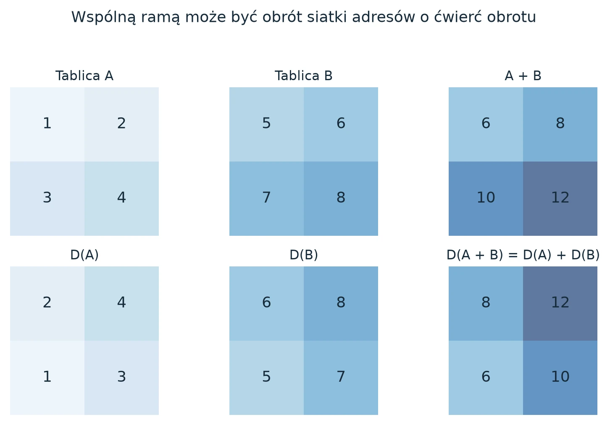</a><a class="infographic-figure-link fig-dark" href="images/04-common-frame-dark.webp" target="_blank" rel="noopener">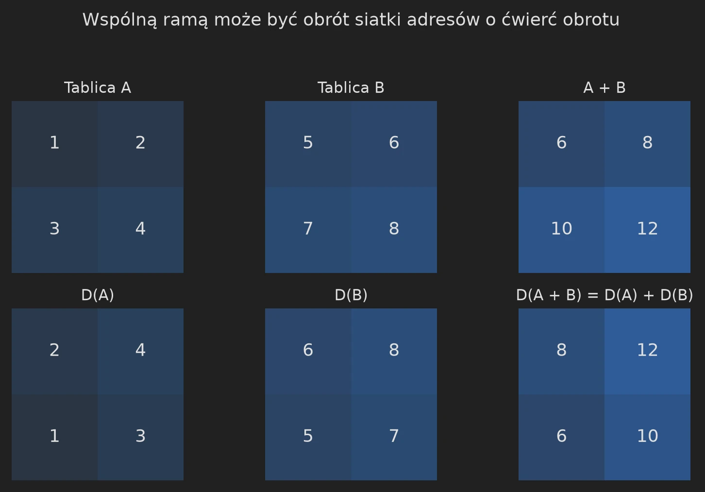</a>
<figcaption><strong>Rys. 11.</strong> Diagram jest przemienny, bo rama jest wspólna. Każdy panel to prawdziwa tablica \(2\times2\). Dolny rząd obraca siatkę adresów górnego. Dodanie dwóch lewych dolnych tablic daje prawą dolną tablicę, czyli dokładnie obrót sumy z górnego rzędu. <small>Ilustracja: Rohan Arun (Apache 2.0), etykiety przetłumaczone.</small></figcaption>
</figure>

Między wierzchołkami z ramami \(D_u,D_v\) zmiana to \(D_vD_u^{-1}\). Prześledzenie tego niezmiennika przez cały układ daje zrealizowany operator

\[
 D_{\rm out}\,\mathsf S_\Omega\,D_{\rm in}^{-1},
\]

gdzie \(\mathsf S_\Omega\) to układ skalarny zastosowany punktowo. Jeśli układ skalarny jest permutacją ról ze znakami, każda ścieżka widzi tylko swoje ramy końcowe i swój znak skalarny. Ramy pośrednie znoszą się algebraicznie, ale ich fizyczne zmiany i tak trzeba opłacić. Tani dobór tych ram to właściwy problem projektowy.

**Dlaczego geometria ma znaczenie.** Praca przypisuje wierzchołkom podprzestrzenie. Porównywalne sąsiednie podprzestrzenie dają kierunki resztowe, których wymiary liczą mniejsze operacje. Niski rząd oznacza mniej niezależnych kierunków do zrealizowania. Macierz z wieloma niezerowymi elementami może mieć rząd jeden; na przykład \(\left(\begin{smallmatrix}1&1\\1&1\end{smallmatrix}\right)\) przenosi tylko jedną niezależną kombinację. Z kolei rzadka macierz jednostkowa ma pełny rząd. Rachunek zależy więc od rzeczywistych operatorów resztowych, ich baz i wkładów końcowych, a nie od liczby widocznych bramek.

Układ bitowy łączy skalary w \(\mathbb F_2\), używając wymiernych etykiet podprzestrzeni dla operatorów adresowych. Układ zespolony łączy diadyczne skalary Gaussa, używając dwójkowych etykiet podprzestrzeni dla operatorów fazowych. To dwa różne zastosowania ciała; mylenie wartości skalarnych z etykietami adresów zaciemnia konstrukcję.

Co zabrać dalej
Odtwarzanie sprawia, że istniejące wiersze mogą służyć za pamięć roboczą. Wspólne ramy zamieniają skalarną zamianę w operację na tablicy. Rzędy resztowe wyceniają zmiany między tymi ramami. Potrzebne są wszystkie trzy własności.

Miejsca w oryginale: <a href="https://github.com/openai/math/blob/adc7f1241b42e322a6451854ab7e4b4c146bf78a/preprints/Integer-multiplication-below-n-log-n-September-23-2026/build/sections/03-motifs.tex"><code>03-motifs.tex</code></a>, <code>lem:scalar-motifs</code>; <code>eq:common-frame-identity</code>.

## Jak znoszą się niechciane źródła

Podstawy Czytaj współczynniki, a nie tylko strzałki układu.

Układ źródłowy tymczasowo łączy wiele wartości. Wyzwanie polega na tym, żeby każdemu celowi zostawić dokładnie to źródło, które jest dla niego przeznaczone. Oryginalna konstrukcja oznacza źródło i cel zbiorami trzyelementowymi. Ich część wspólna może mieć rozmiar zero, jeden, dwa albo trzy. Dwa zbiory trzyelementowe mają trzy wspólne elementy tylko wtedy, gdy są tym samym zbiorem.

Na przykład \(\{1,2,3\}\) i \(\{3,4,5\}\) mają jeden wspólny element, a \(\{1,2,3\}\) i \(\{2,3,4\}\) – dwa. Centralna część konstrukcji zespolonej daje współczynnik \((q-1)/2\), gdy przecięcie ma rozmiar \(q\). Dla czterech możliwości to kolejno \(-1/2,0,1/2,1\). Wkłady boczne znoszą dwa niechciane przypadki niezerowe. Wykres pokazuje oba wkłady i ich sumę.

<figure class="infographic-figure">
<a class="infographic-figure-link fig-light" href="images/21-intersection-cancellation.webp" target="_blank" rel="noopener">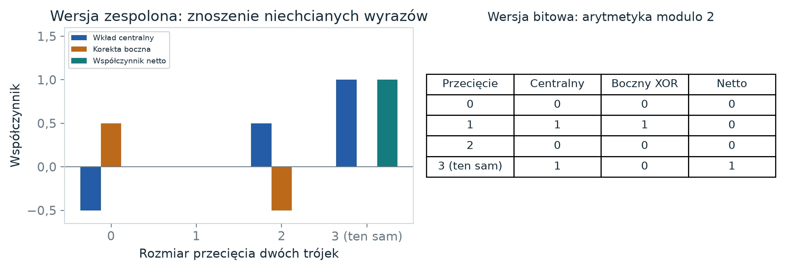</a><a class="infographic-figure-link fig-dark" href="images/21-intersection-cancellation-dark.webp" target="_blank" rel="noopener">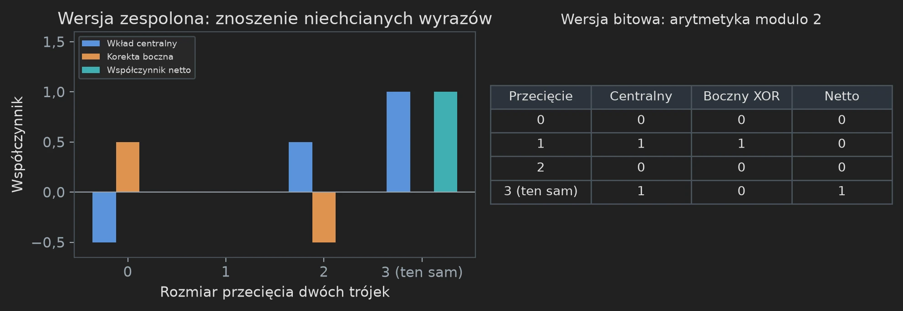</a>
<figcaption><strong>Rys. 12.</strong> Przetrwa tylko wkład własny. Współczynniki zespolone to zwykłe liczby ze znakiem. Konstrukcja bitowa używa arytmetyki modulo dwa, w której \(1+1=0\); jej wkład boczny znosi przypadek przecięcia rozmiaru jeden. Obie dają współczynniki netto \(0,0,0,1\). <small>Ilustracja: Rohan Arun (Apache 2.0), etykiety przetłumaczone.</small></figcaption>
</figure>

Dla celu oznaczonego \(S\) każde inne źródło \(T\) ma więc zerowy współczynnik netto, a źródło \(S\) ma współczynnik jeden. Cel dostaje dokładnie swoją wartość, mimo że wewnętrznie użyto wielu innych wartości. To mocniejsze niż sprawdzenie jednego wygodnego wejścia: opisuje wkład każdego źródła do wyniku.

**Gdzie wchodzi odtwarzanie pamięci roboczej.** Tabela znoszenia dotyczy nowo wprowadzanych wartości źródłowych. Sama nie usuwa dowolnych wartości, które już były w rejestrach pomocniczych. Te wartości początkowe znosi i zwraca osobny harmonogram odtwarzania. Dowód w oryginale potrzebuje obu własności: poprawnego nowego wkładu i niezmienionych pożyczonych danych. Wykres przebiegu rejestrów (rys. 10) pokazuje tę drugą własność na jednym małym przykładzie.

Co zabrać dalej
Zatłoczona sieć może realizować prostą funkcję, bo niechciane współczynniki się znoszą. Dowód musi uwzględnić każdy wkład, także wartości, które początkowo zajmują pamięć roboczą.

## Dlaczego więcej wywołań może oznaczać mniej pracy

Podstawy Licz rozmiar każdego zadania, a nie tylko liczbę zadań.

Przypuśćmy, że krok podwajający szerokość wykonuje trzy mniejsze wywołania, każde na połowie objętości danych. Trzy wywołania brzmią gorzej niż dwa, ale nie oznaczają trzech pełnowymiarowych zadań. Łączna odwiedzona objętość to \(3\cdot(V/2)=1{,}5V\). Na następnym poziomie jest dziewięć wywołań po \(V/4\), łącznie \(2{,}25V\). Pola kół w drzewie odpowiadają tym malejącym objętościom.

<figure class="infographic-figure">
<a class="infographic-figure-link fig-light" href="images/19-recursion-ledger.webp" target="_blank" rel="noopener">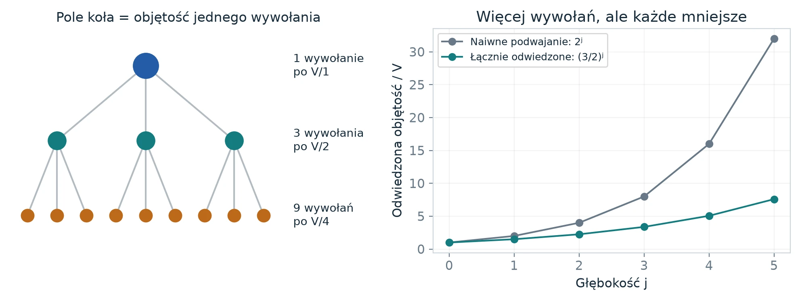</a><a class="infographic-figure-link fig-dark" href="images/19-recursion-ledger-dark.webp" target="_blank" rel="noopener">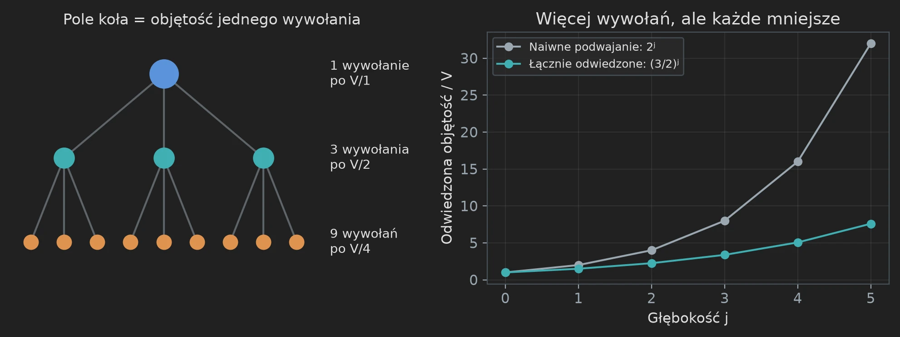</a>
<figcaption><strong>Rys. 13.</strong> Mnożnik wzrostu to liczba wywołań razy względna objętość. To poglądowe drzewo używa \(m=2\), \(W=2\), \(s=3\). Pierwsze trzy poziomy odwiedzają \(V\), \(1{,}5V\) i \(2{,}25V\). Prawy wykres porównuje to z podwajaniem na każdym poziomie. Wywołania mogą wykonywać się po kolei i ponownie używać pamięci; łączna odwiedzona objętość opisuje pracę, a nie szczytowe zużycie pamięci. <small>Ilustracja: Rohan Arun (Apache 2.0), etykiety przetłumaczone.</small></figcaption>
</figure>

Po \(j\) poziomach jest \(3^j\) wywołań, każde na objętości \(V/2^j\). Iloczyn daje \(V(3/2)^j\). Tymczasem czynnik szerokości to \(2^j\). Żeby wyrazić pracę jako potęgę szerokości, rozwiąż \(2^q=3/2\). Daje to \(q=\log_2(3/2)\), około \(0{,}585\), czyli mniej niż jeden. Odpowiadający temu poglądowy koszt rośnie wolniej niż sama szerokość.

**Co musi dodać prawdziwy dowód.** Drzewo liczy tylko pokazane wkłady rekurencyjne. Prawdziwy algorytm w swoich węzłach także przegląda, kopiuje, układa i odtwarza rekordy. Musi ograniczyć ten narzut, obsłużyć szerokości, które nie pasują dokładnie do drzewa, i zachować jeden ustalony opis maszyny. Źródło rezerwuje w nierówności rekurencyjnej ostry zapas na te zadania. Jego liczbowa oszczędność jest znacznie mniejsza niż narysowana tutaj.

**Pytanie kontrolne.** A gdyby każde z trojga dzieci rzeczywiście przetwarzało całą objętość \(V\)? Mnożnik wyniósłby trzy, a nie \(3/2\), i ten argument nie pokonałby już czynnika dwa. Dlatego dzielenie przez \(W\) w pracy jest zobowiązaniem implementacyjnym, a nie kosmetyczną normalizacją.

Co zabrać dalej
Rekurencja liczy pracę ważoną. Wagą jest objętość danych każdego dziecka, łącznie ze skutkami wymaganego układu danych i pamięci roboczej.

## Jak skończona oszczędność rzędu staje się wykładnikiem

Technika Do przeczytania przed zamianą adresów.

Niech \(C(V,f)\) będzie kosztem rekurencyjnym dla objętości \(V\) i parametru szerokości \(f\). Jedna ze schematycznych rekurencji leżących u podstaw argumentu to

\[
 C(V,mf)\le s\,C(V/W,f)+O(V).
\]

Pełna praca uwzględnia warunki dotyczące układu danych i deskryptorów; ten zapis wyodrębnia samo zasadnicze skalowanie. Rodzic wywołuje \(s\) mniejszych operacji, każdą na strumieniu roli o objętości \(V/W\). Podziel przez \(V\) i oznacz przez \(a(f)\) jednostajne ograniczenie kosztu na jednostkę objętości. Wtedy

\[
 a(mf)\le(s/W)a(f)+O(1).
\]

Jeśli \(a(f)\) zachowuje się jak \(f^q\), jego wkład rekurencyjny skaluje się o \(m^q\). Kluczowe porównanie to więc

\[
 \frac{s}{W}<m^q<m,\qquad q<1.
\]

Końcowy dowód używa nierówności ostrych, żeby można było wchłonąć narzut.

<figure class="infographic-figure">
<a class="infographic-figure-link fig-light" href="images/05-recursion.webp" target="_blank" rel="noopener">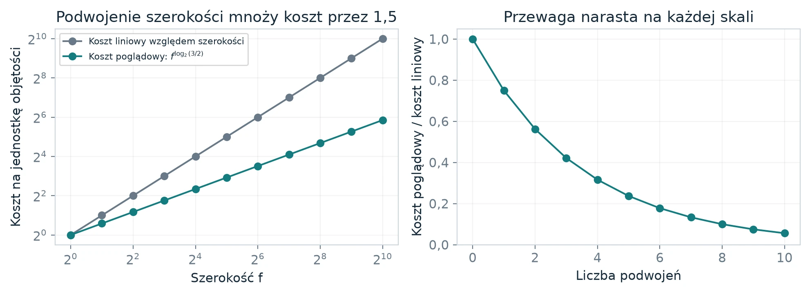</a><a class="infographic-figure-link fig-dark" href="images/05-recursion-dark.webp" target="_blank" rel="noopener">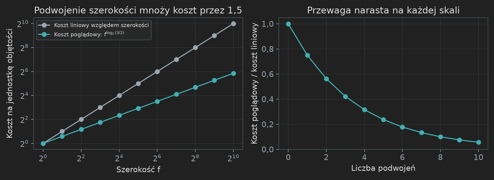</a>
<figcaption><strong>Rys. 14.</strong> Małe dzieci mogą przeważyć dużą liczbę wywołań. Wykres przedstawia poglądową rekurencję z \(m=2\), \(W=2\), \(s=3\); nie jest to sieć z pracy ani pomiar czasu działania. Jej wykładnik rekurencyjny to \(\log_2(3/2)\approx0{,}585\). <small>Ilustracja: Rohan Arun (Apache 2.0), etykiety przetłumaczone.</small></figcaption>
</figure>

Widżet interaktywny wymaga JavaScriptu.

**Dlaczego \(s<Wm\) rozstrzyga sprawę.** Szerokość rosnąca \(m\)-krotnie normalnie kosztowałaby czynnik \(m\). Wkład rekurencyjny rośnie natomiast o \(s/W\). Jeśli \(s=Wm\), to porównanie nie daje ostrej oszczędności w potędze. Jeśli \(s<Wm\), wykładnik mniejszy od jedności może leżeć ostro powyżej \(\log_m(s/W)\). Źródło konstruuje dwie takie nierówności: jedną dla zamiany adresów i jedną dla warstw numerycznych. Ich wymierne górne wykładniki nazywa \(\tau\) i \(\sigma\).

**Maleńki deficyt wciąż daje dodatnią lukę.** Zdefiniuj \(\eta=(Wm-s)/(Wm)\). Algebra daje

\[
 \log_m(s/W)=1+\frac{\log(1-\eta)}{\log m}.
\]

Dla \(0<\eta<1\) logarytm w liczniku jest ujemny. Gdy \(\eta\) jest małe, luka wynosi w przybliżeniu \(\eta/\log m\). Przybliżenie pomaga intuicji; źródło używa dokładnych wymiernych deficytów i ostrych nierówności wykładniczych, żeby poświadczyć wymierny wykładnik. Oryginalny wybór to \(\tau=\sigma=1-2^{-50}\), a nie wyraźnie duża oszczędność z wykresu poglądowego.

**Dlaczego ścinanie łatwiej zbudować niż zamianę.** Ścinanie adresów (ang. *address shear*) aktualizuje jeden blok kombinacją liniową innego: \((H,D)\mapsto(H+AD,D)\). Praca rozkłada wymierną macierz \(A\) rzędu \(a\) na dwa odwracalne czynniki trójkątne i częściową permutację z \(a\) elementami podstawowymi (ang. *pivots*). Aktualizacje trójkątne tanio podążają za porządkiem taśmy. Każdy element podstawowy wymaga jednej mniejszej zamiany. Liczba kosztownych wywołań to więc rząd \(a\). Odpowiednia ustalona nieparzysta liczba pierwsza sprawia, że potrzebne wymierne współczynniki i odwrotności mają sens modulo jej potęgi. Przy przenoszeniu tożsamości wymiernej na adresy modularne nie można ignorować mianowników i odwracalności.

**Mało efektowne warunki są niezbędne.** Prawdziwe szerokości pól nie muszą być potęgami \(m\). Liczby wierszy mogą nie dzielić się przez \(W\). Niektóre układy zawierają między aktywnymi polami pola bierne. Kolejna sekcja źródła usuwa te ograniczenia i płaci za dopełnianie i sprzątanie. Sama poglądowa rekurencja nie dowodzi tych zobowiązań implementacyjnych.

Co zabrać dalej
Skończone świadectwo dostarcza ostrego deficytu. Implementacja taśmowa musi zachować normalizację \(V/W\), żeby ten deficyt zamienił się w oszczędność w wykładniku.

Miejsca w oryginale: <a href="https://github.com/openai/math/blob/adc7f1241b42e322a6451854ab7e4b4c146bf78a/preprints/Integer-multiplication-below-n-log-n-September-23-2026/build/sections/03-motifs.tex"><code>03-motifs.tex</code></a>, <code>eq:explicit-motif-exponents</code>; <a href="https://github.com/openai/math/blob/adc7f1241b42e322a6451854ab7e4b4c146bf78a/preprints/Integer-multiplication-below-n-log-n-September-23-2026/build/sections/04-swap.tex"><code>04-swap.tex</code></a>.

## Co naprawdę zmienia transformata

Podstawy Zastąp listę wartości wagami prostych wzorców.

Transformata to zmiana opisu. Weźmy cztery liczby \([8,4,2,2]\). Zamiast wypisywać te wartości wprost, opisz je jako sumę czterech prostych wzorców. Rysunek pokazuje każdy wkład i wynik. Dodaj pierwszy punkt z każdego z czterech pierwszych wykresów: \(4+3+0+1=8\). W drugim punkcie: \(4+0+1-1=4\). Powtórz to dla pozostałych pozycji, a dostaniesz dwa i dwa.

<figure class="infographic-figure">
<a class="infographic-figure-link fig-light" href="images/15-frequency-patterns.webp" target="_blank" rel="noopener">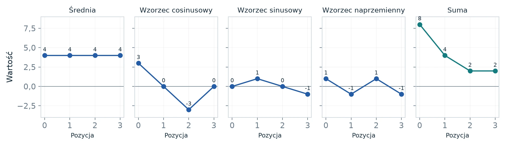</a><a class="infographic-figure-link fig-dark" href="images/15-frequency-patterns-dark.webp" target="_blank" rel="noopener">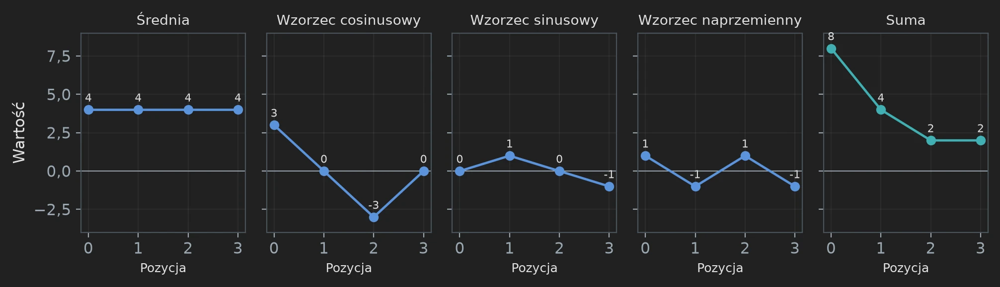</a>
<figcaption><strong>Rys. 15.</strong> Te same cztery liczby w opisie przez wzorce. Średnia \([4,4,4,4]\), wkład cosinusowy \([3,0,-3,0]\), wkład sinusowy \([0,1,0,-1]\) i wkład naprzemienny \([1,-1,1,-1]\) sumują się dokładnie do \([8,4,2,2]\). Linie łączą cztery dyskretne próbki; to nie jest zmierzony dźwięk. <small>Ilustracja: Rohan Arun (Apache 2.0), etykiety przetłumaczone.</small></figcaption>
</figure>

Dlaczego nazywać je częstotliwościami? Średnia nie oscyluje. Wzorce cosinusowy i sinusowy przechodzą jeden pełny cykl na czterech pozycjach, z różnymi fazami początkowymi. Wzorzec naprzemienny zmienia znak w każdym kroku. W tej rzeczywistej bazie wzorców wagi wynoszą \(4,3,1,1\). To nie są cztery zespolone współczynniki Fouriera w konwencji pracy; to równoważny, elementarny sposób przedstawienia tych samych danych rzeczywistych.

**Gdzie pojawiają się liczby zespolone.** Liczba zespolona to para współrzędnych rzeczywistych zapisana jako \(a+ib\). Dodawanie działa współrzędna po współrzędnej. Reguła \(i^2=-1\) sprawia, że mnożenie przez \(i\) obraca płaszczyznę o ćwierć okręgu: \((a,b)\) przechodzi w \((-b,a)\). To wygodna księgowość dla wzorców oscylujących; nie znaczy, że liczby wejściowe albo ich iloczyn są urojone.

<figure class="infographic-figure">
<a class="infographic-figure-link fig-light" href="images/24-complex-turns.webp" target="_blank" rel="noopener">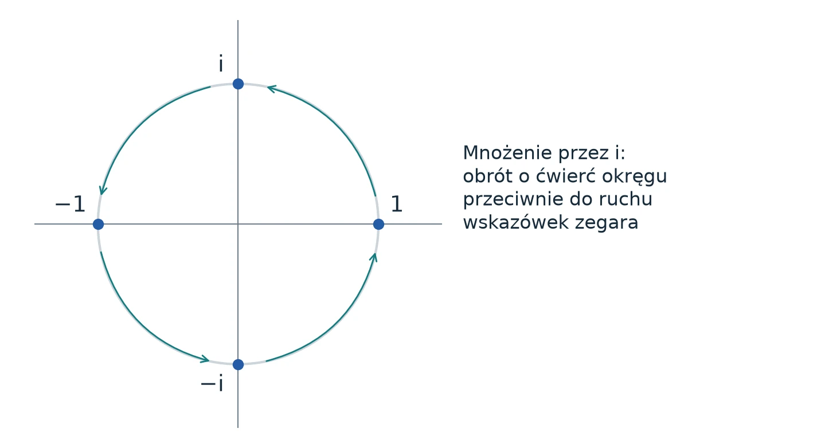</a><a class="infographic-figure-link fig-dark" href="images/24-complex-turns-dark.webp" target="_blank" rel="noopener">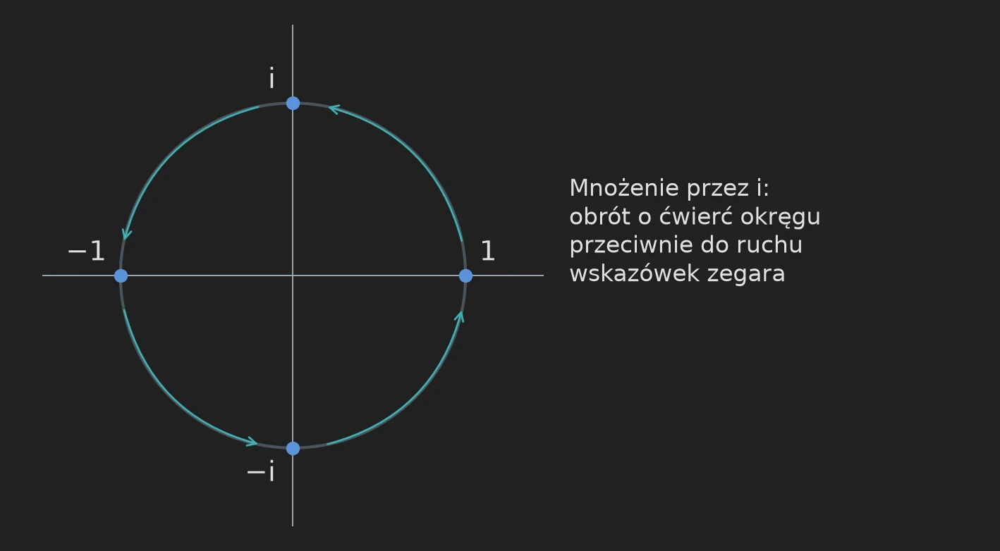</a>
<figcaption><strong>Rys. 16.</strong> Faza to położenie na okręgu. Mnożenie przez \(i\) przechodzi cyklicznie przez \(1,i,-1,-i,1\). Każdy punkt ma moduł jeden. Cztery obroty to najprostszy widoczny przykład pierwiastków z jedynki. <small>Ilustracja: Rohan Arun (Apache 2.0), etykiety przetłumaczone.</small></figcaption>
</figure>

Dla czterech próbek zwykłe, nieznormalizowane współczynniki Fouriera ciągu \([8,4,2,2]\) to \([16,6-2i,4,6+2i]\) w konwencji z ujemnym wykładnikiem. Po podzieleniu przez cztery otrzymujemy wersję znormalizowaną \([4;\ 1{,}5-0{,}5i;\ 1;\ 1{,}5+0{,}5i]\). Średnia to cztery; sprzężone pary zespolone kodują razem wkłady cosinusowy i sinusowy. Nie musisz wyprowadzać tych zespolonych elementów, żeby śledzić resztę przewodnika, ale to rozróżnienie wyjaśnia, dlaczego czynników skali transformaty nie da się zgadnąć.

**Dlaczego to pomaga w mnożeniu.** Przesunięcie listy zmienia fazę każdej częstotliwości w prosty sposób. Splot składa się z ważonych przesunięć, więc w opisie częstotliwościowym staje się mnożeniem odpowiadających sobie składowych, z uwzględnieniem wybranej normalizacji. Trudna praca polega na sprawnej zmianie opisu i dokładnym jej odwróceniu. Pełna praca dodaje starannie dobrane układy danych i reprezentację wielomianową, żeby poradzić sobie z tymi kosztami.

**Co znaczy tu iloczyn tensorowy.** Najpierw zastosuj operację na dwóch elementach do każdej poziomej pary w tablicy \(2\times2\), a potem do każdej pionowej pary. Zastosowanie tej samej operacji osobno w obu kierunkach współrzędnych to jej działanie jako iloczynu tensorowego. Terminologia staje się zwięzła przy wielu osiach, ale znaczenie pozostaje to samo: „wykonaj tę operację w każdym wybranym kierunku, trzymając pozostałe ustalone”.

Co zabrać dalej
Transformata zmienia współrzędne, którymi opisujemy dane. Ustrukturyzowane wzorce mogą sprawić, że w tych współrzędnych operacja staje się tania.

## Najmniejszy krok transformaty, zastosowany na wielu osiach

Technika Do przeczytania przed jednoczesnymi warstwami motylków.

Dwupunktowa znormalizowana transformata Fouriera (najmniejszy „motylek” szybkiej transformacji Fouriera) przekształca

\[
 H_0(u,v)=\left(\frac{u+v}{2},\frac{u-v}{2}\right).
\]

Pierwsze wyjście zapisuje średnią, drugie różnicę. Dla \((u,v)=(6,2)\) wyjścia to \((4,2)\). Oryginał odzyskasz jako \(u=4+2\), \(v=4-2\). Czynnik \(1/2\) ma znaczenie: to nie jest nieznormalizowana macierz Hadamarda ani macierz unitarna z czynnikiem \(1/\sqrt2\).

<figure class="infographic-figure">
<a class="infographic-figure-link fig-light" href="images/06-butterfly.webp" target="_blank" rel="noopener">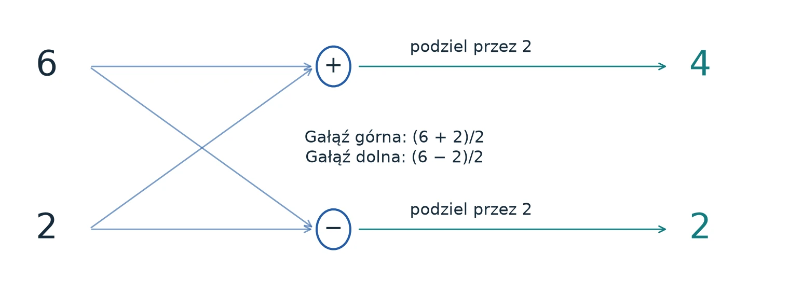</a><a class="infographic-figure-link fig-dark" href="images/06-butterfly-dark.webp" target="_blank" rel="noopener">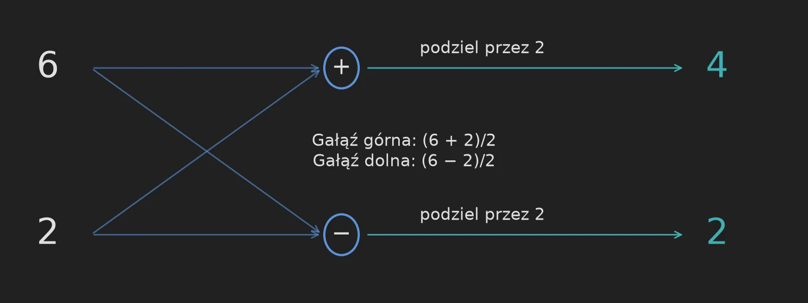</a>
<figcaption><strong>Rys. 17.</strong> Prześledź dwie gałęzie arytmetyczne. Oba wejścia trafiają do obu operacji. Gałąź plus zwraca cztery, a gałąź minus dwa, po podzieleniu przez dwa. Wartości to przykład obliczeniowy, a nie pośrednie wartości z dużej sieci. <small>Ilustracja: Rohan Arun (Apache 2.0), etykiety przetłumaczone.</small></figcaption>
</figure>

W przykładzie z dwiema osiami zacznij od czterech elementów \([8,4,2,2]\) w porządku adresów \(00,01,10,11\). Zastosowanie \(H_0\) do sąsiednich par daje \([6,2,2,0]\). Zastosowanie go wzdłuż drugiego bitu, czyli do par pozycji zero i dwa oraz jeden i trzy, daje \([4,1,2,1]\). To działanie \(H_0\otimes H_0\).

Widżet interaktywny wymaga JavaScriptu.

Jeśli każde wejście ma moduł zespolony co najwyżej \(M\), to każde wyjście również: \(|u\pm v|/2\le(|u|+|v|)/2\le M\). Ukończona operacja jest więc kontrakcją w normie maksimum. Zastosowanie jej na kilku bitach adresu oznacza łączenie w pary rekordów różniących się wybranym bitem, dla każdego ustawienia pozostałych bitów. Naiwna implementacja wykonuje jedno przejście przez całą tablicę na każdą wybraną oś. Proponowany algorytm warstwowy organizuje te operacje wspólnie.

**Dlaczego praca tymczasowo używa innego jądra.** Zdefiniuj \(X\) jako zamianę dwóch elementów, \(\mathsf S=\operatorname{diag}(1,i)\), \(a=(1+i)/2\), \(b=(1-i)/2\) oraz \(C=aI+bX\). Przydatne tożsamości to

\[
 C^2=X,\quad C^4=I,\qquad H_0=b\mathsf S C\mathsf S.
\]

Jądro \(C\) dobrze współpracuje z dwójkowymi ramami fazowymi, którymi wycenia się kierunki resztowe. Po ukończeniu jego warstwy tensorowej fazy diagonalne i znany diadyczny czynnik zespolony dają pożądaną warstwę \(H_0\). To klasyczne tożsamości liniowe; użycie macierzy fazowych nie wymaga komputera kwantowego.

**Jedno zaokrąglenie na końcu, a nie po każdej bramce.** Wartości wewnętrzne to dokładne diadyczne liczby Gaussa (ang. *Gaussian dyadics*): liczby, których część rzeczywista i urojona są liczbami całkowitymi podzielonymi przez potęgi dwójki. Wartości pomocnicze mogą rosnąć, nawet jeśli ukończona warstwa \(H_0\) jest kontrakcją. Dowód potrzebuje więc bitów zapasu na wewnętrzne moduły i mianowniki. Wykonuje całą warstwę dokładnie i obcina dopiero na jej granicy. Sama kontrakcyjność nie uzasadniałaby odrzucania bitów po każdej aktualizacji pomocniczej.

**Dlaczego wybrane bity tworzą wyjątkowe adresy.** Wydajna aktualizacja upakowanych adresów może zgadzać się z pożądaną zmianą bazy dwójkowej na większości adresów, podczas gdy przeniesienia zaburzają mały, jawnie opisany zbiór. Praca wyodrębnia ten zbiór i naprawia go deterministycznie. Dowód potrzebuje zgodności poza nim, niezmienniczości zbioru wyjątkowego oraz ograniczenia kosztu wyjęcia, posortowania i ponownego wstawienia pełnych rekordów. „Rzadki” nie znaczy losowy ani pomijalny: każde wejście musi być obsłużone poprawnie.

Co zabrać dalej
Druga oszczędność grupuje arytmetykę z wielu osi. Musi przetrwać zmiany bazy, wzrost wartości pośrednich i dokładną korektę wyjątkowych rekordów.

Miejsca w oryginale: <a href="https://github.com/openai/math/blob/adc7f1241b42e322a6451854ab7e4b4c146bf78a/preprints/Integer-multiplication-below-n-log-n-September-23-2026/build/sections/05-layers.tex"><code>05-layers.tex</code></a>, <code>eq:phase-C</code>; <code>eq:phase-basic-identities</code>.

---

**Wstecz:** [część 1 – problem i splot](/posts/mnozenie-liczb-calkowitych-1-problem-i-splot/). **Dalej:** [część 3 – od transformaty do dokładnego wyniku](/posts/mnozenie-liczb-calkowitych-3-od-transformaty-do-wyniku/).

## Źródła

1. Rohan Arun, [*Integer multiplication, illustrated*](https://github.com/rohanarun/integer-multiplication-illustrated) – wydanie ilustrowane, Apache 2.0.
2. OpenAI, [*Integer multiplication below n log n*](https://github.com/openai/math/tree/adc7f1241b42e322a6451854ab7e4b4c146bf78a/preprints/Integer-multiplication-below-n-log-n-September-23-2026), 23 września 2026, commit `adc7f12`.
3. [CrocSwap/integer-mult-bounds](https://github.com/CrocSwap/integer-mult-bounds) – prace społeczności; [lista współtwórców](https://github.com/CrocSwap/integer-mult-bounds/blob/main/CONTRIBUTORS.md).
4. D. Harvey, J. van der Hoeven, [*Integer multiplication in time O(n log n)*](https://annals.math.princeton.edu/2021/193-2/p04), Annals of Mathematics 193 (2021).
5. H. J. Nussbaumer, *Fast polynomial transform algorithms for digital convolution*, IEEE Trans. ASSP 28 (1980).
