

Autor i przekład
<strong>Autor:</strong> <a href="https://github.com/rohanarun/integer-multiplication-illustrated">Rohan Arun</a>, <em>Integer multiplication, illustrated</em> – ilustrowane wydanie pracy OpenAI <em>Integer multiplication below n log n</em> (23 września 2026). Według noty autora objaśnienia, rysunki i skrypty przygotowano przy istotnej pomocy OpenAI Codex.

<strong>Przekład na język polski i wizualizacje interaktywne:</strong> wygenerowane z pomocą Claude (Anthropic), przygotował <a href="https://github.com/hipotures/rad/tree/main/research/integer-multiplication-bounds">hipotures</a>.

Licencja: <a href="https://www.apache.org/licenses/LICENSE-2.0">Apache 2.0</a>. Zmiany względem oryginału: przekład tekstu, przetłumaczone etykiety rysunków, widżety interaktywne oraz ramki „Od tłumacza”. Status wyniku i ujawnienia opisuje <a href="/posts/mnozenie-liczb-calkowitych-1-problem-i-splot/">część 1</a>.

Seria

<ol>
<li><a href="/posts/mnozenie-liczb-calkowitych-1-problem-i-splot/">Problem i splot</a></li>
<li><a href="/posts/mnozenie-liczb-calkowitych-2-rama-rzad-rekurencja/">Rama, rząd i rekurencja</a></li>
<li class="is-current">Od transformaty do dokładnego wyniku (ta część)</li>
</ol>

Cały przewodnik w jednym pliku: <a href="/posts/mnozenie-liczb-calkowitych-1-problem-i-splot/przewodnik-mnozenie-pl.pdf">PDF, 33 strony</a> (bez widżetów interaktywnych).

Od tłumacza
Po części 2 wiemy, skąd bierze się oszczędność. Ta część pokazuje, co ją zjada i co trzeba jeszcze udowodnić: pierwiastki z jedynki stają się przesunięciami ze znakiem, siatki trzeba przepróbkować, błąd przybliżeń musi zmieścić się w ostrym budżecie, a końcowy wykładnik ogranicza najmniejszy z siedmiu marginesów kosztu. Na końcu jest lista kontrolna do oceny kolejnych ulepszeń i słowniczek.

## Pierwiastki z jedynki jako przesunięcia ze znakiem

Technika Do przeczytania przed transformatami syntetycznymi i iloczynami w pierścieniu.

Transformata zwykle mnoży wartości przez pierwiastki z jedynki. W reprezentacji syntetycznej sama wartość jest krótkim wielomianem, przechowywanym jako lista współczynników. Pracujemy w

\[
 \mathcal R_r=\mathbb C[y]/(y^r+1).
\]

Oznacza to, że \(y^r\) zastępujemy przez \(-1\). Mnożenie przez \(y\) przesuwa listę współczynników i zmienia znak współczynnika, który się zawija.

<figure class="infographic-figure">
<a class="infographic-figure-link fig-light" href="images/07-signed-shift.webp" target="_blank" rel="noopener">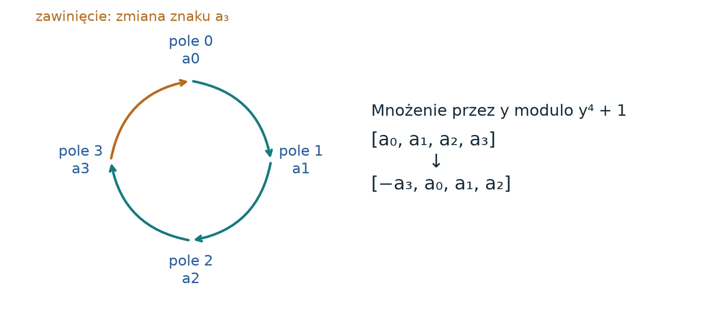</a><a class="infographic-figure-link fig-dark" href="images/07-signed-shift-dark.webp" target="_blank" rel="noopener">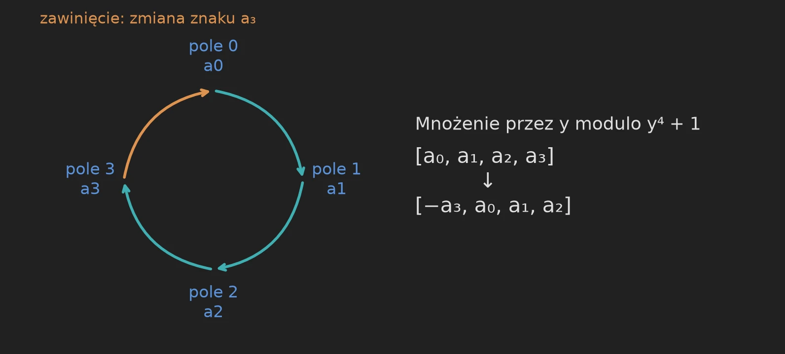</a>
<figcaption><strong>Rys. 18.</strong> Operacja na pierwiastku staje się dokładnym przesunięciem danych. Dla \(r=4\) iloczyn \(y(a_0+a_1y+a_2y^2+a_3y^3)\) redukuje się do \(-a_3+a_0y+a_1y^2+a_2y^3\). Ta operacja nie wymaga żadnego przybliżonego mnożenia trygonometrycznego. <small>Ilustracja: Rohan Arun (Apache 2.0), etykiety przetłumaczone.</small></figcaption>
</figure>

Dla potęgi dwójki \(t\) dzielącej \(2r\) element \(\omega_t=y^{2r/t}\) służy za pierwiastek transformaty. Jego potęgi działają jak permutacje współczynników ze znakami. Źródło dowodzi potrzebnego znoszenia się charakterów bezpośrednio. Ma to znaczenie, bo pierścień ilorazowy ma dzielniki zera: dzielenie przez element, który wygląda na niezerowy, nie jest automatycznie dozwolone.

**Zachowaj kolejność, którą algorytm naturalnie produkuje.** Rekurencyjna transformata Fouriera często zwraca częstotliwości w kolejności z odwróconymi bitami. Dla długości cztery ta kolejność to 0, 2, 1, 3. Jeśli obie przetransformowane dane wejściowe mają tę samą kolejność, odpowiadające sobie elementy nadal można mnożyć. Sortowanie każdej transformaty do ładniejszej kolejności dodałoby pracy, nie zmieniając matematycznego iloczynu. Transformata przeciwna jest napisana tak, by przyjmować kolejność, która rzeczywiście występuje.

**Normalizacja jest częścią interfejsu.** Obie transformaty w tym manuskrypcie zawierają czynnik \(1/t\). W konsekwencji \(F_t^+F_t^-=I/t\), a nie \(I\). Przy tej konwencji dla splotu cyklicznego długości \(t\)

\[
 F_t^+\bigl((F_t^-u)\odot(F_t^-v)\bigr)=\frac{u*v}{t^2}.
\]

Jeden czynnik \(t\) pochodzi z normalizacji iloczynu w przód, a drugi ze znormalizowanej transformaty przeciwnej. Utrata któregokolwiek zniszczyłaby dokładne odtworzenie. Wersje wielowymiarowe zastępują \(t\) iloczynem długości osi, z uwzględnieniem permutacji zachowanych w źródle.

**Dlaczego mnożenie wielomianów nie czyni dowodu błędnym kołem.** Elementy punktowe są teraz wielomianami, więc ich iloczyny wciąż trzeba obliczyć. Źródło pakuje ograniczone współczynniki ze znakiem w większe liczby całkowite z odstępem wystarczającym do odzyskania każdego współczynnika. Jawnie obsługuje wyodrębnianie wycentrowane, znaki i zawijanie ujemnocykliczne (ang. *negacyclic*). Do mnożenia tych krótszych liczb wywołuje wcześniej ustalony mnożnik \(O(N\log N)\), a nie ulepszony algorytm, który próbuje uzasadnić. Długość wejścia \(N\) w tych wywołaniach różni się od pierwotnego \(n\), a wszystkie wywołania są ujęte w końcowej tabeli kosztów.

Co zabrać dalej
Zmiana reprezentacji może zastąpić kosztowne skalarne mnożenia przez pierwiastki dokładnymi przesunięciami ze znakiem, ale układ danych i skalowanie wciąż kosztują.

Miejsca w oryginale: <a href="https://github.com/openai/math/blob/adc7f1241b42e322a6451854ab7e4b4c146bf78a/preprints/Integer-multiplication-below-n-log-n-September-23-2026/build/sections/06-transforms.tex"><code>06-transforms.tex</code></a>, <code>lem:synthetic-characters</code>; <code>lem:signed-ring-product</code>.

## Zmiana siatki bez sortowania wszystkiego

Technika Do przeczytania przed przepróbkowaniem gaussowskim.

Naturalny układ splotu i wydajny układ transformaty syntetycznej nie mają tych samych długości osi. Redukcja mnożenia używa osi źródłowych o długościach parami względnie pierwszych; transformaty syntetyczne wolą potęgi dwójki. Przepróbkowanie gaussowskie (ang. *Gaussian resampling*) łączy je starannie kontrolowanymi odwzorowaniami liniowymi. To analityczny most, a nie zwykłe zaokrąglanie indeksu do najbliższego sąsiada.

W jednym wymiarze źródło podaje tożsamość postaci

\[
 P_sF_s=2^{2\alpha^2}B_0P_tF_tA.
\]

Tutaj \(A\) odwzorowuje siatkę źródłową długości \(s\) na dłuższą siatkę długości \(t\), a \(B_0\) odwzorowuje z powrotem. Operatory \(P\) to permutacje współrzędnych. Odwzorowania są realizowane w przybliżeniu z podaną precyzją, z jawnymi ograniczeniami błędu i czasu. Duży znany skalar jest uwzględniany przy odtwarzaniu. Nierówności wiążące \(s,t,\alpha,p\) to założenia tego interfejsu, a nie ozdoba, którą można pominąć przy zmianie parametrów.

**Dlaczego pozostawienie permutacji we wzorze oszczędza czas.** Niech \(P\) przestawia współrzędne. Jeśli dwie tablice używają tego samego przestawienia, to

\[
 (PA)\odot(PB)=P(A\odot B).
\]

Odpowiadające sobie częstotliwości wciąż są poprawnie sparowane. Odbiorca, który zna tę kolejność, może ich użyć bezpośrednio. Ta prosta tożsamość wyjaśnia, skąd bierze się ta możliwość; źródło dowodzi bardziej szczegółowych tożsamości potrzebnych, by wszystkie jego permutacje źródłowe i docelowe były zgodne z transformatą przeciwną.

<figure class="infographic-figure">
<a class="infographic-figure-link fig-light" href="images/08-permutations.webp" target="_blank" rel="noopener">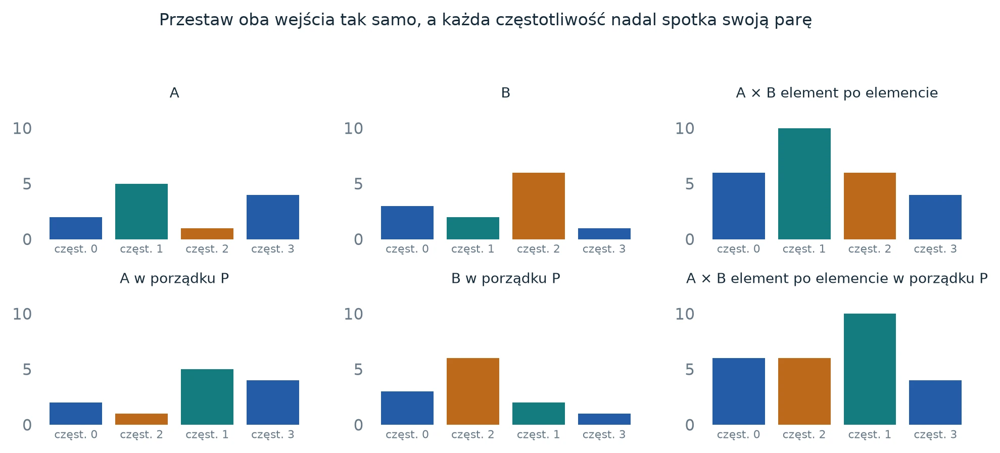</a><a class="infographic-figure-link fig-dark" href="images/08-permutations-dark.webp" target="_blank" rel="noopener">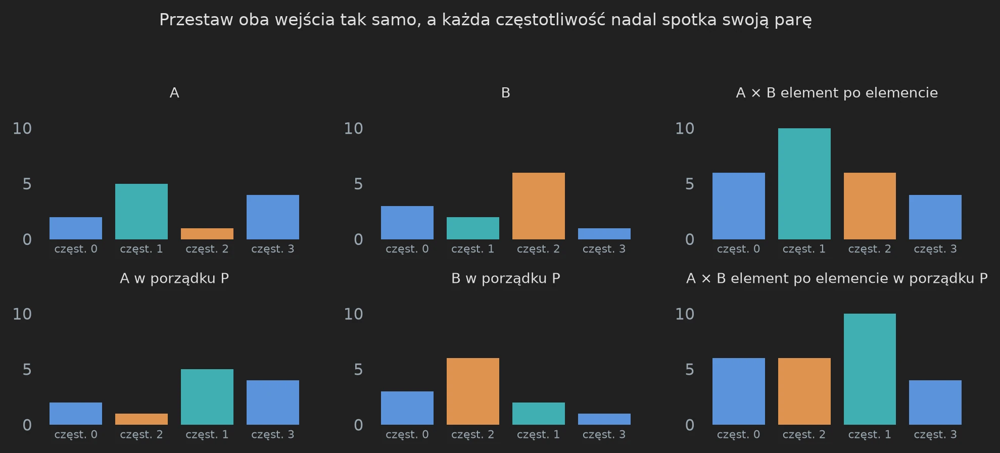</a>
<figcaption><strong>Rys. 19.</strong> Spójność może usunąć zbędne przestawianie. Słupki pokazują tę samą permutację zastosowaną do obu konkretnych czynników i do ich iloczynu po elementach \([6,10,6,4]\). Sam diagram nie dowodzi, że dowolna implementacja transformaty odwrotnej przyjmie tę kolejność. Musi to zapewnić jej interfejs. <small>Ilustracja: Rohan Arun (Apache 2.0), etykiety przetłumaczone.</small></figcaption>
</figure>

**Gdzie pasuje tożsamość chirp.** Tożsamość Bluesteina (algorytm Bluesteina, ang. *chirp-z*) przepisuje dwuliniowy wykładnik za pomocą \(2jk=j^2+k^2-(j-k)^2\). Kwadratowe czynniki fazowe na wejściach i wyjściach zamieniają transformatę w splot ze znanym sygnałem chirp. Oryginalny dowód trzyma odpowiednią permutację wewnątrz tego rachunku. Kolejne skręcenie fazy godzi splot cykliczny z ujemnocykliczną relacją wielomianową \(y^r=-1\). Każde skręcenie i jego usunięcie ma koszt zarówno algebraiczny, jak i precyzyjny.

**Budżet błędu ma dwa różne rodzaje wzrostu.** W złożeniu dokładnych kontrakcji istniejący błąd nie jest wzmacniany, więc lokalne błędy przybliżeń można dodawać. Cofnięcie znanej dużej normalizacji mnoży jednak błąd bezwzględny. Błędem byłoby więc wnioskować: „wszystkie transformaty są kontrakcjami, więc wynik końcowy jest dokładny”, nie śledząc przeskalowania. Źródło wybiera precyzję roboczą wystarczającą, by przetrwać zarówno skumulowany błąd lokalny, jak i końcowe wzmocnienie.

Co zabrać dalej
Układ danych jest częścią kontraktu algorytmu dotyczącego wejścia i wyjścia. Zachowanie użytecznej kolejności ma wartość tylko wtedy, gdy każdy kolejny krok ją akceptuje.

Miejsca w oryginale: <a href="https://github.com/openai/math/blob/adc7f1241b42e322a6451854ab7e4b4c146bf78a/preprints/Integer-multiplication-below-n-log-n-September-23-2026/build/sections/07-resampling.tex"><code>07-resampling.tex</code></a>, <code>lem:no-sort-resampling</code>; <a href="https://github.com/openai/math/blob/adc7f1241b42e322a6451854ab7e4b4c146bf78a/preprints/Integer-multiplication-below-n-log-n-September-23-2026/build/sections/08-assembly.tex"><code>08-assembly.tex</code></a>.

## Mały błąd musi pozostać mały po przeskalowaniu

Podstawy Budżet liczbowy, który można sprawdzić ręcznie.

Wyobraź sobie przybliżone obliczenie, którego bieżący błąd bezwzględny wynosi co najwyżej \(0{,}01\). Przepuszczenie go przez dokładną kontrakcję nie powiększa tego błędu. Jeśli następne przybliżenie dodaje co najwyżej \(0{,}02\), nowe ograniczenie błędu to co najwyżej \(0{,}03\). To suma w najgorszym przypadku: nie zakładamy, że błędy się znoszą albo zachowują losowo.

Teraz przywróć czynnik skali osiem. Ograniczenie błędu staje się równe \(8\cdot0{,}03=0{,}24\), czyli bezpiecznie poniżej jednej drugiej. Gdyby czynnik skali wynosił 32, ograniczenie wyniosłoby \(0{,}96\). Ta słabsza gwarancja nie uzasadnia zaokrąglenia do właściwej liczby całkowitej.

<figure class="infographic-figure">
<a class="infographic-figure-link fig-light" href="images/20-error-budget.webp" target="_blank" rel="noopener">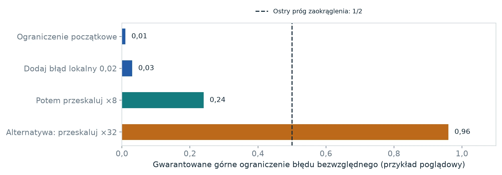</a><a class="infographic-figure-link fig-dark" href="images/20-error-budget-dark.webp" target="_blank" rel="noopener">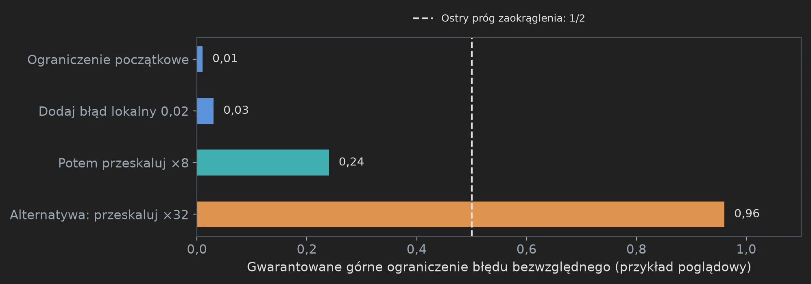</a>
<figcaption><strong>Rys. 20.</strong> Mały błąd wewnętrzny to nie to samo co błąd końcowy. Dwa ostatnie słupki to alternatywne przeskalowania tego samego ograniczenia \(0{,}03\), a nie kolejne operacje. Przekroczenie \(1/2\) oznacza, że to ograniczenie nie wystarcza do zagwarantowania dokładnego zaokrąglenia; nie dowodzi, że rzeczywisty wynik jest błędny. <small>Ilustracja: Rohan Arun (Apache 2.0), etykiety przetłumaczone.</small></figcaption>
</figure>

Dowód w źródle ma większe i bardziej złożone normalizacje, ale zasada jest ta sama. Budżetuje błędy lokalne, ogranicza rozmiary wartości pośrednich i śledzi mnożenie błędu przy cofaniu skal. Potrzebuje też dość bitów na pośrednie dokładne wartości diadyczne, nawet gdy ukończona transformata jest kontrakcją.

**Dlaczego nierówność musi być ostra.** Jeśli prawdziwa liczba całkowita to 12, wynik leżący ostro między \(11{,}5\) a \(12{,}5\) zaokrągla się jednoznacznie do 12. Dla dokładnie \(12{,}5\) odległość do 12 i do 13 jest taka sama, więc dopuszczalny błąd „co najwyżej jedna druga” nie rozstrzyga, o którą liczbę chodziło. Praca dowodzi ostrego ograniczenia końcowego dla każdego współczynnika, a potem wykonuje dokładne przeniesienia.

Co zabrać dalej
Przybliżenia dają się pogodzić z dokładnym wynikiem, jeśli udowodnimy, że błąd po pełnym przeskalowaniu jest mniejszy niż połowa odstępu między liczbami całkowitymi.

## Dlaczego poprawienie jednej części może niczego nie zmienić

Podstawy Końcową oszczędność ogranicza najsłabszy margines.

Przypuśćmy, że trzy operacje mają znormalizowane koszty \(p^{0{,}80}\), \(p^{0{,}97}\) i \(p^{0{,}90}\). Ich marginesy poniżej pełnej potęgi \(p\) wynoszą \(0{,}20\), \(0{,}03\) i \(0{,}10\). Dla dużych \(p\) najszybciej rośnie wyraz \(p^{0{,}97}\) i to on decyduje o wykładniku sumy.

Spraw, by pierwsza operacja była znacznie tańsza, zmieniając \(p^{0{,}80}\) na \(p^{0{,}60}\). Jej margines rośnie do \(0{,}40\), ale sumą wciąż rządzi \(p^{0{,}97}\). Zamiast tego popraw drugą operację do \(p^{0{,}92}\). Teraz najmniejszy margines wynosi \(0{,}08\), więc łączny wykładnik też może się poprawić, z zastrzeżeniem pozostałego narzutu i wymagań ostrego zapasu.

<figure class="infographic-figure">
<a class="infographic-figure-link fig-light" href="images/22-bottleneck.webp" target="_blank" rel="noopener">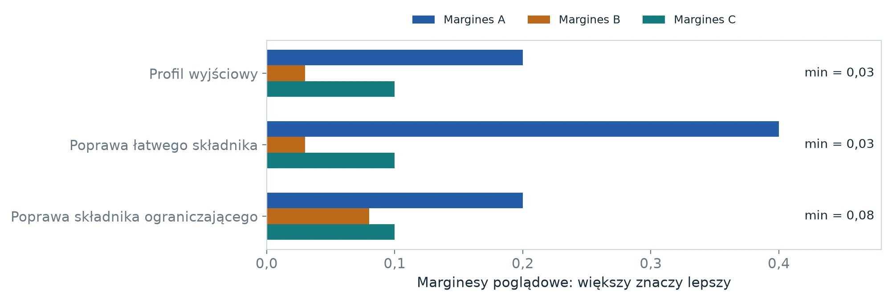</a><a class="infographic-figure-link fig-dark" href="images/22-bottleneck-dark.webp" target="_blank" rel="noopener">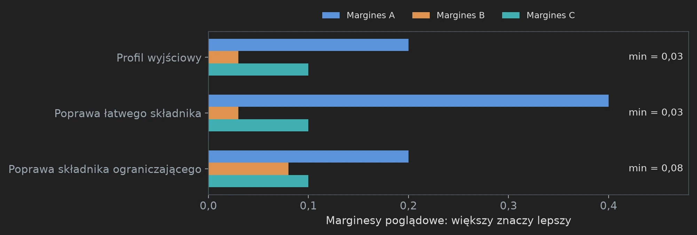</a>
<figcaption><strong>Rys. 21.</strong> Lokalny zysk nie musi poprawić ogólnego wykładnika. Każdy wiersz to osobny profil poglądowy, a nie wynik historyczny. Większe marginesy są lepsze. Minimum pozostaje równe \(0{,}03\), gdy poprawia się łatwy wyraz, i rośnie do \(0{,}08\), gdy poprawia się wyraz ograniczający. <small>Ilustracja: Rohan Arun (Apache 2.0), etykiety przetłumaczone.</small></figcaption>
</figure>

Końcowy rachunek w źródle ma siedem dominujących wyrazów zamiast trzech. Rysunek w kolejnym objaśnieniu technicznym pokazuje ich rzeczywiste oryginalne marginesy. Skala logarytmiczna sprawia, że skrajnie małe wartości dodatnie stają się widoczne. Ten wykres odwraca konwencję wizualną: dalej w prawo oznacza mniejszy margines, bo oś to minus logarytm marginesu. Zawsze najpierw przeczytaj oś, a dopiero potem oceniaj, który słupek jest lepszy.

**Dlaczego potrzebny jest odrobinę większy zapas.** Koszt może też zawierać czynniki takie jak \((\log p)^2\). Taki czynnik rośnie wolniej niż dowolna ustalona dodatnia potęga \(p^\rho\), ale nie jest stałą. Wybranie końcowej oszczędności ostro poniżej dostępnego marginesu zostawia miejsce na wchłonięcie tych czynników dla dostatecznie dużych \(p\). Równość na granicy nie uzasadniałaby tego samego argumentu.

Co zabrać dalej
Śledź cały profil kosztów. Ulepszenie liczy się dla głównego wyniku tylko wtedy, gdy pozwalają na to wszystkie wyrazy ograniczające i interfejsy.

## Dokładność i czas działania razem

Technika Do przeczytania przed końcowym dowodem składającym całość.

Praca ma dwie linie mety. Musi zwrócić dokładny iloczyn, a każda część obliczenia musi zmieścić się w deklarowanym ograniczeniu czasu. Te zobowiązania łączą się przez precyzję i objętość danych, ale żadne nie zastępuje drugiego.

**Dokładność z ostrego przedziału błędu.** Pożądane współczynniki splotu \(c_j\) są liczbami całkowitymi. Jeśli obliczenie daje przybliżenie \(\widetilde c_j\) spełniające \(|\widetilde c_j-c_j|<1/2\), zaokrąglenie do najbliższej liczby całkowitej odtwarza \(c_j\) jednoznacznie. Ograniczenie musi obowiązywać *po* przywróceniu wszystkich normalizacji transformat i skal cyfr. Remis dokładnie przy \(1/2\) nie wystarcza. Po odtworzeniu współczynników przeniesienia i zapis dwójkowy to dokładne operacje na liczbach całkowitych.

<figure class="infographic-figure">
<a class="infographic-figure-link fig-light" href="images/09-rounding.webp" target="_blank" rel="noopener">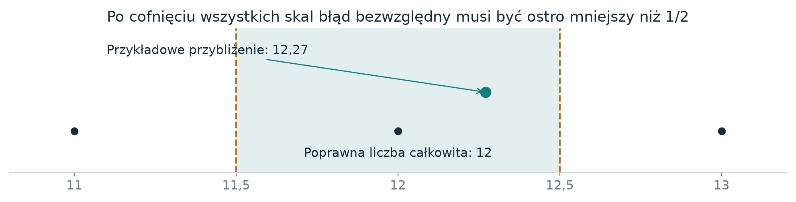</a><a class="infographic-figure-link fig-dark" href="images/09-rounding-dark.webp" target="_blank" rel="noopener">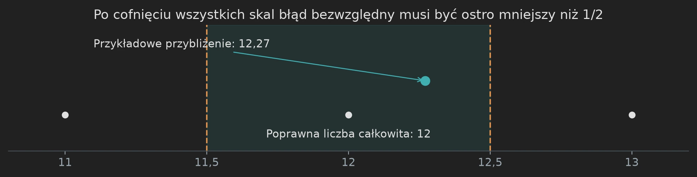</a>
<figcaption><strong>Rys. 22.</strong> Przybliżona arytmetyka wewnątrz, dokładny wynik na wyjściu. Wartość \(12{,}27\) to przykład dydaktyczny. Dowód w źródle daje jednolite ograniczenie dla każdego odtwarzanego współczynnika; ten rysunek nie mierzy rzeczywistego błędu numerycznego. <small>Ilustracja: Rohan Arun (Apache 2.0), etykiety przetłumaczone.</small></figcaption>
</figure>

W oryginalnym składaniu źródło używa szerokości cyfry \(b=\lceil\log_2 n\rceil\) i precyzji roboczej \(p=6b\). W przybliżeniu jest \(n/b\) cyfr i \(\Theta(p)\) przechowywanych bitów na współczynnik, co daje dopełnioną objętość \(V=Tp=\Theta(n)\). Ta zależność zamienia koszty na przechowywany bit w ograniczenie wyrażone przez pierwotny rozmiar wejścia.

**Siedem konkurujących rachunków.** Końcowa tabela rozdziela operacje, które różnie skalują się z \(p\). Zapisz znormalizowany wyraz jako \(p^{1-g_i}\); wtedy \(g_i\) to jego margines poniżej pełnej potęgi \(p\). Przy \(d=\Theta(p^\epsilon)\), \(K=\Theta(p^{\epsilon c})\) i \(\ell=\Theta(p^{1-\epsilon})\) marginesy wynoszą

\[
\begin{aligned}
 g_1&=1-\epsilon(1+c), & g_2&=\epsilon c(1-\tau),\\
 g_3&=\epsilon(1-\lambda'), & g_4&=1-\tau-\epsilon(2-\tau),\\
 g_5&=\tfrac14-\delta-\tfrac32\epsilon, & g_6&=1-\delta-\epsilon,\\
 g_7&=\epsilon. &&
\end{aligned}
\]

Sumą rządzi *najmniejszy* margines. Powiększenie marginesu, który już jest duży, może nie mieć żadnego wpływu na główny wykładnik.

<figure class="infographic-figure">
<a class="infographic-figure-link fig-light" href="images/10-margins.webp" target="_blank" rel="noopener">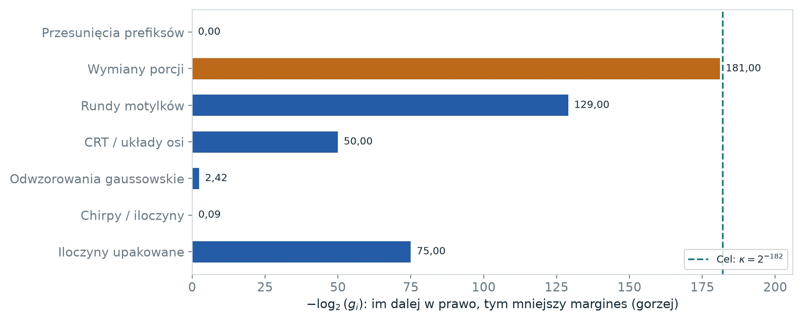</a><a class="infographic-figure-link fig-dark" href="images/10-margins-dark.webp" target="_blank" rel="noopener">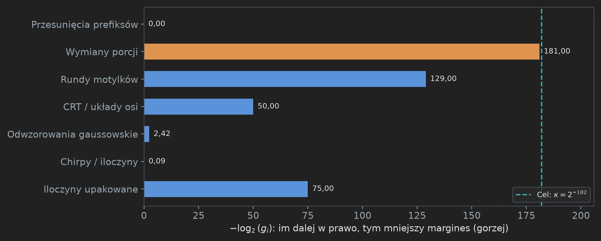</a>
<figcaption><strong>Rys. 23.</strong> Oryginalny wybór parametrów ma wyraźne wąskie gardło. Te wartości wyliczono z dokładnych wymiernych parametrów oryginału, a nie oszacowano z pomiarów czasu. Oś pozioma to \(-\log_2 g_i\): dłuższe słupki oznaczają mniejszą oszczędność. Wymiany porcji mają \(g_2=2^{-181}\); wybrana oszczędność końcowa to \(\kappa=2^{-182}\). <small>Ilustracja: Rohan Arun (Apache 2.0), etykiety przetłumaczone.</small></figcaption>
</figure>

**Przeczytaj jeden wiersz do końca.** Przy wymianach w układzie transformaty jest \(O(p/K)\) zamian szerokości \(K\). Każda kosztuje \(O(VK^\tau)\). Łącznie daje to

\[
 O(VpK^{\tau-1})
 =O\bigl(Vp^{1-\epsilon c(1-\tau)}\bigr).
\]

To dokładnie drugi margines \(g_2\). Małe wielkości się mnożą: mały wykładnik wzrostu szerokości \(\epsilon c\) i mała oszczędność zamiany \(1-\tau\) dają jeszcze mniejszy margines końcowy. To wyjaśnia, dlaczego imponujący lokalny pomysł może dać w całym algorytmie bardzo mały wykładnik asymptotyczny.

**Dlaczego rezerwujemy ostry zapas.** Niech \(G=\min_i g_i\). Ustalone potęgi \(\log p\) można wchłonąć, jeśli \(\kappa<G\), bo \((\log p)^C=o(p^{G-\kappa})\) dla ustalonego \(C\). Oryginalny ostrożny wybór daje \(G=2\kappa\). Koszt końcowy mieści się wtedy w

\[
 O(Vp^{1-\kappa})=O\bigl(n(\log n)^{1-\kappa}\bigr).
\]

Ten argument działa od pewnego miejsca. Jeden ustalony próg obejmuje wszystkie potrzebne nierówności; poniżej niego maszyna używa mnożenia szkolnego. Powiększenie stałej w notacji \(O\) obejmuje skończony zbiór mniejszych długości. Ustanowienie pełnej jednolitej implementacji pozostaje częścią zobowiązań dowodowych.

**Co próbują poprawić późniejsze ulepszenia społeczności.** Niektóre ulepszenia zmieniają skończoną sieć albo cenę przejść między jej ramami; inne ponownie wykorzystują pamięć roboczą, zmieniają sposób łączenia etapów albo ulepszają wybór parametru zewnętrznego. Działają one na różnych poziomach. Nowy skończony profil wciąż trzeba związać z jego rzeczywistym układem, a potem przeprowadzić przez odpowiednią rekurencję i analizę kosztów. Oryginalny diagram siedmiu marginesów pomaga czytać ten zamrożony manuskrypt; nie twierdzi, że każda późniejsza konstrukcja używa tego samego rachunku ani że pokazuje najnowsze świadectwo społeczności.

Co zabrać dalej
Dokładne odtworzenie wymaga ostrego ograniczenia błędu; wykładnik wymaga ostrego marginesu w każdym dominującym koszcie. Oba muszą odnosić się do tego samego algorytmu.

Miejsca w oryginale: <a href="https://github.com/openai/math/blob/adc7f1241b42e322a6451854ab7e4b4c146bf78a/preprints/Integer-multiplication-below-n-log-n-September-23-2026/build/sections/08-assembly.tex"><code>08-assembly.tex</code></a>, <code>eq:fixed-parameters</code>; <code>eq:margin-list</code>; <code>eq:final-error</code>.

## Co właściwie mówi udane sprawdzenie

Podstawy Trzy twierdzenia, których nie należy mylić.

„To działa” może znaczyć różne rzeczy. Układ może zwracać właściwe wartości na określonym skończonym zbiorze wejść. Fizyczny program może wykonywać ten układ z udowodnionym ograniczeniem zasobów. Twierdzenie może obejmować każdą długość wejścia, także rozmiary, których żaden eksperyment nie uruchomi. Każde z nich jest cenne, ale to różne stwierdzenia.

<figure class="infographic-figure">
<a class="infographic-figure-link fig-light" href="images/23-proof-obligations.webp" target="_blank" rel="noopener">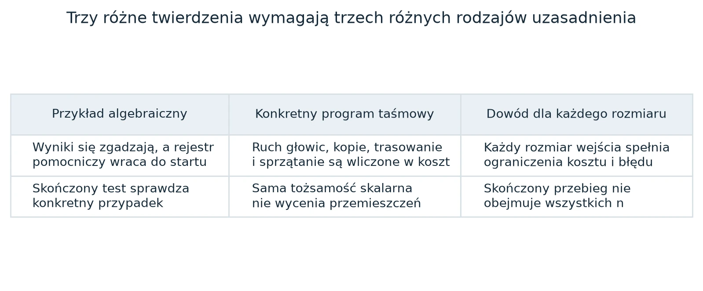</a><a class="infographic-figure-link fig-dark" href="images/23-proof-obligations-dark.webp" target="_blank" rel="noopener">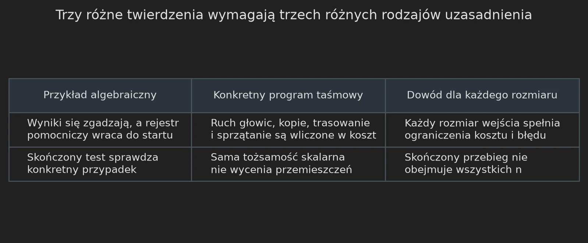</a>
<figcaption><strong>Rys. 24.</strong> Odczytuj twierdzenie na poziomie, który wspierają jego dowody. Kolumny rozdzielają skończoną algebrę, fizyczną implementację i analizę dla wszystkich rozmiarów. To zobowiązania, które trzeba połączyć, a nie konkurencyjne sposoby dowodzenia tego samego. <small>Ilustracja: Rohan Arun (Apache 2.0), etykiety przetłumaczone.</small></figcaption>
</figure>

**Konkretny przykład.** Wykres rejestrów (rys. 10 w części 2) pokazuje, że cztery aktualizacje działają, gdy rejestr pomocniczy zaczyna od siedmiu. Rachunek symboliczny dowodzi odtworzenia dla dowolnych wartości w podanym pierścieniu. Żadne z tych stwierdzeń nie mówi, ile ruchu na taśmie potrzebuje implementacja na ogromnej tablicy. To wymaga innego argumentu. Podobnie sprawdzenie siedmiu wymiernych marginesów weryfikuje arytmetykę w ramach modelu kosztów; nie ustanawia każdego założenia algorytmicznego tego modelu.

**Dlaczego przewodnik oznacza przykłady poglądowe.** Duże, widoczne różnice wykładników pomagają się uczyć, ale przedstawione jako zmierzone przyspieszenie zniekształcałyby pracę. Małe macierze i tablice mogą pokazać niezmiennik, nie będąc rzeczywistą skończoną konstrukcją. Podpisy mówią, które liczby pochodzą ze źródła, a które są przykładami dydaktycznymi. Nowe generatory rysunków sprawdzają pokazaną arytmetykę, żeby ilustracje objaśniały prawdziwe tożsamości, a nie tylko sugestywne obrazki.

**Po lekturze przewodnika.** Czytelnik powinien umieć opisać, dlaczego splot pomaga, dlaczego przesuwanie danych kosztuje czas, dlaczego wspólne ramy zachowują dodawanie, jak ważona rekurencja oszczędza w wykładniku i dlaczego odtworzenie wymaga ostrego budżetu błędu. Prześledzenie każdego szczegółu twierdzenia źródłowego wciąż wymaga dalszej nauki algebry liniowej, analizy Fouriera i dowodów złożonościowych. Wydanie rozszerzone umieszcza oryginalne argumenty bezpośrednio po materiale objaśniającym.

Co zabrać dalej
Zrozumienie architektury to istotny krok. Nie jest to jednak to samo co niezależne zweryfikowanie każdej części twierdzenia.

## Co z tego wynika i co wciąż trzeba sprawdzić

Technika Do przeczytania przed końcowymi wnioskami i dodatkiem.

**Dzielenie i pierwiastek kwadratowy.** Szybkie mnożenie jest elementem składowym innych działań arytmetycznych. Iteracje w stylu Newtona poprawiają przybliżenia odwrotności albo pierwiastka kwadratowego przy geometrycznie rosnącej precyzji. Jeśli koszt przy precyzji \(n\) to \(M(n)\), a mniejsze etapy kosztują \(M(n/2),M(n/4),\ldots\), to przy regularnym ograniczeniu z tego manuskryptu sumą rządzi największy etap. Przybliżone wyniki wciąż trzeba skorygować: dzielenie sprawdza iloraz i resztę, a całkowity pierwiastek kwadratowy używa dokładnych porównań kwadratów. Sama procedura przybliżająca nie jest jeszcze algorytmem dokładnego dzielenia ani części całkowitej pierwiastka.

**Transpozycja macierzy.** Praca powołuje się na zewnętrzną redukcję mnożenia do przestawienia macierzy z porządku wierszowego w kolumnowy. Uwzględnia całkowitą liczbę bitów macierzy, a nie tylko długość jej boku. To wynik o permutacji danych. Nie jest to twierdzenie o wykładniku mnożenia macierzy, które jest innym problemem. Redukcja i konwersje formatu wejścia zachowują własne założenia i koszty.

**Dodatek o pogrupowanych prostokątach.** Dodatek rozszerza operacje na upakowanych adresach na zbiór kompletnych bloków prostokątnych. „Prostokąt” oznacza tu iloczyn kartezjański przedziałów adresów, a nie geometryczne przybliżenie dowolnych danych. Pełne dane i informacje o miejscu docelowym muszą być wliczone w koszt, gdy wyjątkowe rekordy są wyjmowane i naprawiane. Ten materiał wspiera szczegóły układu danych, a nie wprowadza osobnego głównego ulepszenia.

**Praktyczna lista kontrolna.** Oceniając proponowane ulepszenie, zadaj te pytania po kolei:

1. Jaką dokładnie operację skalarną wykonuje wygenerowany układ przy dowolnych początkowych wartościach pomocniczych? Czy przywraca obiecaną pamięć roboczą?
2. Czy wszystkie wystąpienia każdej bramki mają wymaganą wspólną ramę? Czy uwzględniono wszystkie zmienione operatory, znaki, wkłady źródeł i końce?
3. Czy opłacony profil rzędów opisuje ten układ, a nie wersję złagodzoną albo schematyczną? Czy specjalizacje do ciał skończonych są uzasadnione?
4. Czy implementacja rekurencyjna naprawdę daje każdemu dziecku objętość \(V/W\), z wliczonym trasowaniem, dopełnianiem, kopiowaniem i odtwarzaniem?
5. Czy kontrakty precyzji i przepróbkowania nadal obowiązują dla nowych układów danych?
6. Czy każdy końcowy margines kosztu i błąd odtworzenia mieszczą się ostro w wymaganych granicach przy tym samym wyborze parametrów?

Te pytania rozdzielają algebrę, implementację i analizę asymptotyczną. Sukces na jednym poziomie jest użytecznym świadectwem na tym poziomie; nie załatwia po cichu pozostałych.

**Weryfikacja wykonana dla tego wydania.** Zamrożone pliki oryginału sprawdzono z dostarczonym manifestem SHA-256. Ponownie obliczono przykład splotu cyfr, tożsamość odtwarzania w czterech krokach na 343 trójkach liczb całkowitych, przykład motylka na dwóch osiach i wszystkie siedem oryginalnych marginesów wymiernych. Drugie wydanie sprawdza też interpolację, rekonstrukcję wzorców częstotliwości, tożsamości ram dla wektorów i tablic, znoszenie się przecięć, zgodność permutacji i poglądowe budżety błędu. Rysunki są generowane z tych przykładów albo z jawnie oznaczonych tożsamości schematycznych. Kompilacja i przegląd wyrenderowanych stron sprawdzają integralność i czytelność dokumentu. Żadne z tych działań nie stanowi nowego audytu pełnego twierdzenia o mnożeniu.

Co zabrać dalej
Przewodnik wyjaśnia architekturę dowodu i jego interfejsy. Szczegółowe argumenty zawiera materiał źródłowy; niezależna weryfikacja pełnego twierdzenia to osobne zadanie badawcze.

## Oznaczenia i mapa źródła

Technika Do korzystania podczas lektury części technicznych.

| Symbol lub termin | Znaczenie w przewodniku i oryginalnej argumentacji |
|---|---|
| \(n\) | Długość każdej liczby wejściowej w bitach. |
| \(b\) | Szerokość cyfry w bitach w oryginalnym składaniu. |
| \(p\) | Precyzja robocza; oryginalnie \(p=6\lceil\log_2 n\rceil\). |
| \(V\) | Logiczna objętość przechowywanych bitów w węźle rekurencji. |
| \(W\) | Liczba wszystkich ról w ustalonej skończonej sieci, łącznie z pomocniczymi. |
| \(m\) | Ustalony wymiar sieci i mnożnik szerokości w rekurencji. |
| \(s\) | Liczba opłaconych mniejszych wywołań w omówieniu rekurencji; w przepróbkowaniu ta sama litera oznacza długość źródła. |
| \(d\) | Liczba osi transformaty, rosnąca powoli z precyzją. |
| \(K\) | Szerokość upakowanej porcji adresu; skaluje się jak \(p^{\epsilon c}\). |
| \(r,\ell\) | Długość wielomianu i jej logarytm dwójkowy. |
| \(T\) | Rozmiar dopełnionego pudełka transformaty; \(Tp=\Theta(n)\). Nie mylić z funkcją czasu \(T(n)\) ani z trójką oznaczoną \(T\). |
| \(\tau,\sigma\) | Wymierne górne wykładniki dla rekurencji bitowej i zespolonej. |
| \(\lambda'\) | Wykładnik w koszcie ukończonej warstwy jednoczesnej, po narzucie. |
| \(\kappa\) | Końcowa oszczędność w wykładniku \(\log n\). |
| rola / wiersz | Ustalona pozycja przewodu w układzie / kompletny ciągły blok sufiksu. |
| rama | Odwracalny operator reprezentacji na tablicy indeksowanej adresami w jednej roli. |
| deficyt rzędu | Różnica między pełnym liniowym budżetem wywołań \(Wm\) a opłaconym budżetem \(s\). |
| diadyczna liczba Gaussa | Liczba zespolona z mianownikami będącymi potęgami dwójki w obu składowych. |
| warunkowy | Wniosek zależy od zachowanych interfejsów, których pełnej niezależnej walidacji nie zapewnia skończone świadectwo. |

**Gdzie znaleźć poszczególne warstwy oryginału.** Nazwy plików poniżej są zachowane w pakiecie źródłowym. Etykiety twierdzeń są stabilniejszymi odnośnikami niż numery stron.

| Pytanie | Plik oryginału |
|---|---|
| Jaka maszyna jest liczona? | [`02-streams.tex`](https://github.com/openai/math/blob/adc7f1241b42e322a6451854ab7e4b4c146bf78a/preprints/Integer-multiplication-below-n-log-n-September-23-2026/build/sections/02-streams.tex) |
| Co robi skończona sieć? | [`03-motifs.tex`](https://github.com/openai/math/blob/adc7f1241b42e322a6451854ab7e4b4c146bf78a/preprints/Integer-multiplication-below-n-log-n-September-23-2026/build/sections/03-motifs.tex) |
| Jak rząd wycenia przemieszczenia? | [`04-swap.tex`](https://github.com/openai/math/blob/adc7f1241b42e322a6451854ab7e4b4c146bf78a/preprints/Integer-multiplication-below-n-log-n-September-23-2026/build/sections/04-swap.tex) |
| Jak grupuje się wiele motylków? | [`05-layers.tex`](https://github.com/openai/math/blob/adc7f1241b42e322a6451854ab7e4b4c146bf78a/preprints/Integer-multiplication-below-n-log-n-September-23-2026/build/sections/05-layers.tex) |
| Jak wykonuje się transformaty i iloczyny w pierścieniu? | [`06-transforms.tex`](https://github.com/openai/math/blob/adc7f1241b42e322a6451854ab7e4b4c146bf78a/preprints/Integer-multiplication-below-n-log-n-September-23-2026/build/sections/06-transforms.tex) |
| Jak pasują rozmiary siatek i permutacje? | [`07-resampling.tex`](https://github.com/openai/math/blob/adc7f1241b42e322a6451854ab7e4b4c146bf78a/preprints/Integer-multiplication-below-n-log-n-September-23-2026/build/sections/07-resampling.tex) |
| Gdzie łączy się dokładność i wszystkie koszty? | [`08-assembly.tex`](https://github.com/openai/math/blob/adc7f1241b42e322a6451854ab7e4b4c146bf78a/preprints/Integer-multiplication-below-n-log-n-September-23-2026/build/sections/08-assembly.tex) |
| Jakie są dalsze konsekwencje? | [`09-exact-arithmetic.tex`](https://github.com/openai/math/blob/adc7f1241b42e322a6451854ab7e4b4c146bf78a/preprints/Integer-multiplication-below-n-log-n-September-23-2026/build/sections/09-exact-arithmetic.tex), [`10-transposition.tex`](https://github.com/openai/math/blob/adc7f1241b42e322a6451854ab7e4b4c146bf78a/preprints/Integer-multiplication-below-n-log-n-September-23-2026/build/sections/10-transposition.tex) |

## Od tłumacza: słowniczek polsko-angielski

Część terminów ma ustalone polskie odpowiedniki, ale wiele pochodzi z najnowszej literatury (Harvey i van der Hoeven, praca OpenAI) albo jest specyficzna dla tej jednej konstrukcji i nie ma polskiej nazwy. Kolumna „Status” rozróżnia te przypadki. „Ustalony” oznacza, że termin w tym znaczeniu znalazłem w polskich źródłach wymienionych pod tabelą. „Przyjęty w przekładzie” oznacza, że polskiego odpowiednika nie znalazłem i zaproponowałem własny; przy pierwszym użyciu w tekście podany jest wtedy termin angielski.

| Polski | Angielski (oryginał) | Status |
|---|---|---|
| splot; splot cykliczny (kołowy) | convolution; cyclic (circular) convolution | ustalony [1] |
| szybka transformacja Fouriera | fast Fourier transform | ustalony [2] |
| motylek, graf motylkowy | butterfly, butterfly graph | ustalony [2, 3] |
| kolejność z odwróconymi bitami | bit-reversed order | ustalony [3] |
| pierwiastek z jedynki | root of unity | ustalony [4] |
| logarytm iterowany \(\log^*\) | iterated logarithm | ustalony [5] |
| kontrakcja (odwzorowanie zwężające) | contraction | ustalony [6] |
| element podstawowy | pivot | ustalony [7] |
| liczby całkowite Gaussa | Gaussian integers | ustalony [8] |
| przepróbkowanie | resampling | ustalony [9] |
| przeniesienie; podstawa systemu liczbowego | carry; radix | ustalony |
| rząd macierzy, podprzestrzeń, iloczyn tensorowy | rank, subspace, tensor product | ustalony |
| maszyna Turinga, taśma, głowica | Turing machine, tape, head | ustalony |
| przepróbkowanie gaussowskie | Gaussian resampling | przyjęty w przekładzie |
| splot / zawijanie ujemnocykliczne | negacyclic convolution / wrapping | przyjęty w przekładzie |
| chirp, algorytm Bluesteina | chirp, Bluestein’s (chirp-z) algorithm | brak polskiego odpowiednika¹ |
| diadyczna liczba Gaussa | Gaussian dyadic | przyjęty w przekładzie |
| ścinanie adresów | address shear | przyjęty w przekładzie² |
| rama (reprezentacji) | frame | przyjęty w przekładzie³ |
| rząd resztowy, deficyt rzędu | residual rank, rank deficit | przyjęty w przekładzie |
| rola, wiersz, porcja adresu | role, row, address chunk | przyjęty w przekładzie³ |
| rejestr pomocniczy, pamięć robocza | scratch register, workspace | opisowy |
| margines, wąskie gardło | margin, bottleneck | opisowy |
| przykład poglądowy | toy example | opisowy |
| warunkowy (wynik) | conditional (result) | opisowy |

¹ Słowniki podają tylko potoczne „świergot” lub „ćwierkanie”. ² „Ścinanie” jest ustalone w mechanice; jako przekształcenie liniowe pojawia się po polsku głównie w dokumentacji programów graficznych. ³ Terminy specyficzne dla tej jednej konstrukcji.

Źródła terminologii: [1] Wikipedia, [Splot (analiza matematyczna)](https://pl.wikipedia.org/wiki/Splot_%28analiza_matematyczna%29), sekcja „Splot cykliczny (kołowy)”; [2] Wikipedia, [Szybka transformacja Fouriera](https://pl.wikipedia.org/wiki/Szybka_transformacja_Fouriera) („struktury motylkowe”); [3] K. Snopek, [wykład o DFT i FFT](https://www.ire.pw.edu.pl/~ksnopek/ASISP/wyk11.pdf), Politechnika Warszawska („motylek”, „graf motylkowy”, „odwrócona kolejność bitów”); [4] Wikipedia, [Pierwiastek z jedynki](https://pl.wikipedia.org/wiki/Pierwiastek_z_jedynki); [5] Wikipedia, [Logarytm iterowany](https://pl.wikipedia.org/wiki/Logarytm_iterowany); [6] zasada odwzorowań zwężających Banacha, np. [skrypt UG o metrycznej teorii punktów stałych](https://mfi.ug.edu.pl/sites/mfi.ug.edu.pl/files/_nodes/news/112650/files/sem-lic-mat-strobin-wybrane-zagadnienia-metrycznej-teorii-punktow-stalych.pdf); [7] P. F. Góra, [wykład z metod numerycznych](https://th-www.if.uj.edu.pl/zfs/gora/metnum17/wyklad02.pdf), UJ („element podstawowy (ang. pivot)”); [8] Wikipedia, [Liczby całkowite Gaussa](https://pl.wikipedia.org/wiki/Liczby_ca%C5%82kowite_Gaussa); [9] np. polski opis patentowy [PL3053163T3](https://patents.google.com/patent/PL3053163T3/en) („przepróbkowanie sygnału audio”).

Uwaga o „transformacie”: polska Wikipedia rozróżnia *transformację* (przekształcenie) i *transformatę* (jego wynik). W tekście, zgodnie z częstym użyciem w fizyce i przetwarzaniu sygnałów, „transformata” oznacza czasem także samo przekształcenie.

---

**Wstecz:** [część 2 – rama, rząd i rekurencja](/posts/mnozenie-liczb-calkowitych-2-rama-rzad-rekurencja/) · [część 1 – problem i splot](/posts/mnozenie-liczb-calkowitych-1-problem-i-splot/).

## Źródła

1. Rohan Arun, [*Integer multiplication, illustrated*](https://github.com/rohanarun/integer-multiplication-illustrated) – wydanie ilustrowane, przewodnik (31 s.) i wydanie rozszerzone z oryginalnymi dowodami (105 s.), Apache 2.0.
2. OpenAI, [*Integer multiplication below n log n*](https://github.com/openai/math/tree/adc7f1241b42e322a6451854ab7e4b4c146bf78a/preprints/Integer-multiplication-below-n-log-n-September-23-2026), 23 września 2026, commit `adc7f12`.
3. [CrocSwap/integer-mult-bounds](https://github.com/CrocSwap/integer-mult-bounds) – prace społeczności nad warunkowymi ulepszeniami κ; [lista współtwórców](https://github.com/CrocSwap/integer-mult-bounds/blob/main/CONTRIBUTORS.md).
4. hipotures, [projekt RaD: integer-multiplication-bounds](https://github.com/hipotures/rad/tree/main/research/integer-multiplication-bounds).
5. D. Harvey, J. van der Hoeven, [*Integer multiplication in time O(n log n)*](https://annals.math.princeton.edu/2021/193-2/p04), Annals of Mathematics 193 (2021); [wersja HAL](https://hal.archives-ouvertes.fr/hal-02070778).
6. L. I. Bluestein, *A linear filtering approach to the computation of discrete Fourier transform*, IEEE Trans. Audio Electroacoustics 18 (1970).
7. H. J. Nussbaumer, *Fast polynomial transform algorithms for digital convolution*, IEEE Trans. ASSP 28 (1980).
